# Research on the face expression recognition system based on CNN + RestNet + VGG models using source code, models, and defense materials.

I. Introduction 1.1 Research Background Facial Expression Recognition (Facial Expression Recognition) in Daily Life

# I. Introduction

## 1.1 Research background

**Facial expression recognition (Facial Expression Recognition )**

In daily life and work, the ways of expressing emotions mainly include language, voice, body movements (such as gestures), and facial expressions. Among these behaviors, facial expressions carry the richest information about human inner emotional activities. According to research, the proportion of inner activities conveyed by human facial expressions is the highest among all the above forms, accounting for approximately 55%.

Human facial expressions can convey changes in their inner emotions, reflecting the true essence of their inner world. In the 1970s, renowned American psychologist Paul Ekman conducted extensive experiments and defined six basic facial expressions as **sadness, fear, disgust, happiness, anger, and surprise**. Additionally, they established corresponding databases for different facial expression categories. As research progressed, the neutral expression was also included in the basic facial expressions, forming the seven fundamental facial expressions in today's face recognition studies.

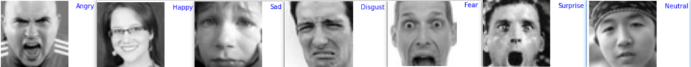

Editor

Due to the different facial expressions, they can reflect the emotional and psychological changes in people under different circumstances. Therefore, the recognition of facial expressions has significant research significance and practical application value for studying human behavior and psychological activities. At present, facial expression recognition mainly uses computer analysis to recognize human facial expressions, thereby analyzing the emotional changes. This is of great significance in human-computer interaction, social network analysis, remote medical care, and criminal investigation monitoring.

## 1.2 Research Significance

In computer vision, as facial expression recognition serves as a bridge between humans and machines, it can better assist machines in understanding and recognizing human inner activities, thereby enhancing the service to humanity. Therefore, conducting in-depth research on facial expression recognition is of great significance. In the process of studying facial expressions, how to effectively extract facial expression features is the most crucial step in facial expression recognition. Facial expression recognition has been around for decades, and in the past, it was mainly based on manually designed features (such as edge and texture descriptions) and machine learning techniques (such as Principal Component Analysis, Linear Discriminant Analysis, or Support Vector Machines). However, in unconstrained environments, manually designing features for different situations is difficult, and it is also easily influenced by external factors (such as lighting, angle, complex backgrounds), which leads to a decline in recognition rates.

With the advancement of science and technology, traditional methods for extracting facial expression features based on manual extraction have been hindered by their requirement for researchers to possess extensive experience and significant limitations, thereby presenting considerable challenges to research in facial expression recognition. With the rise of deep learning, convolutional neural networks, as a classic representative of deep learning, due to their ability to automatically extract facial expression image features, have gradually become popular for facial expression feature extraction based on deep learning, progressively replacing some traditional methods. The main advantage of deep learning methods lies in their ability to learn optimal functions through training with large datasets.In deep learning, using convolutional neural networks as tools for facial expression feature extraction can more comprehensively extract facial expression features, solving the problem of insufficient facial expression feature extraction by traditional manual methods.

The facial expression recognition algorithm can be classified based on feature extraction methods, which mainly fall into two categories: one is the traditional computer vision-based extraction algorithm. This category relies on researchers manually designing to extract facial expression features; the other is the deep learning-based algorithm. This method uses convolutional neural networks to automatically extract facial expression features. After simple preprocessing of the raw image, it can be directly input into the network and employ end-to-end learning methods, i.e., without going through the complex intermediate modeling process of traditional machine learning, such as data labeling and flipping processing in recognition. The data is labeled in a single step, while simultaneously learning the features and performing classification, which is an important distinction between deep learning methods and traditional methods.Compared with manual selection and design of image features, convolutional neural networks can obtain deep feature information through automatic learning, which has better noise resistance, projection invariance, generalization and generalization ability, and abstract semantic representation ability.

# II. Theoretical Analysis and Research

## 2.1 Facial Expression Recognition Framework

Facial expression recognition can generally be divided into four processes. Includes **image acquisition,** Facial detection. Image preprocessing and emotion classification. Among them, Facial detection. Facial feature extraction and facial expression classification are three key steps in facial expression recognition, as shown in the basic framework of facial expression recognition below.

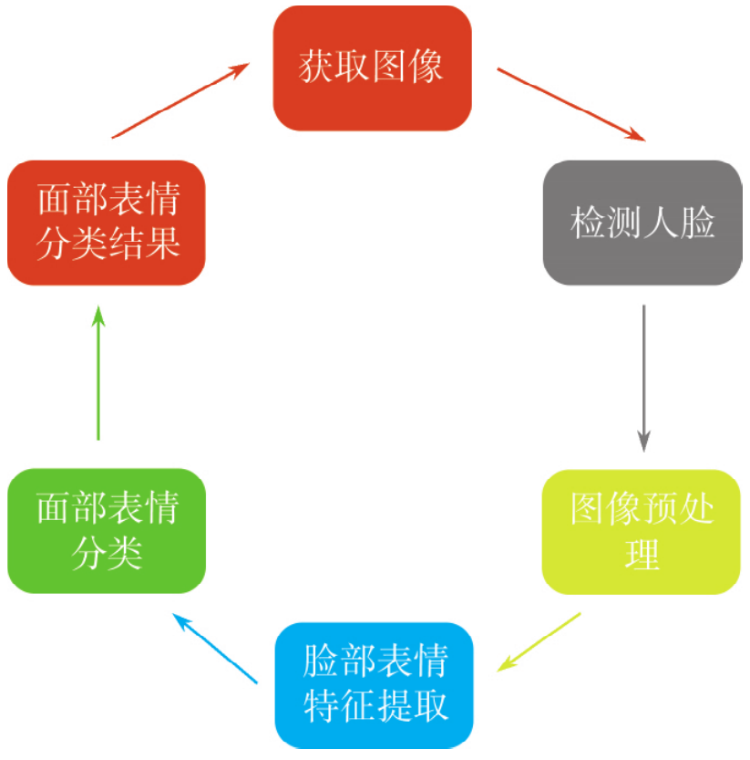

Firstly, obtain the image and perform facial detection, then extract only the parts of the image containing faces. The extracted facial expressions are uneven in proportion and grayscale, thus it is necessary to segment and normalize the facial feature regions. The normalization mainly involves uniform processing of facial lighting and positioning, reshaping the image into a standard size, such as an 48×48 pixel image, which is referred to as preprocessing. Then, extract facial expression features from the face images and classify them. Convolutional Neural Networks (CNN) are used to complete the tasks of feature extraction and classification because CNN is a well-known model that mimics the human brain's work and establishes the structure of convolutional neural networks. Therefore, CNN is selected as the foundation for constructing the model architecture. Finally, continuous training, optimization, and finally achieving accurate recognition of facial expressions.

**Image Preprocessing**

Geometric normalization using Doppler broadening is divided into two main steps: face correction and face trimming.

The main purpose is to convert images into a unified size.

Specific steps are as follows:

(1) Identify the key points and mark them. Firstly, select the eyes and nose as three key points, and use a function to mark them, here we choose the function ［x, y］=ginput(3). The important point is to obtain the coordinates of the key points, which can be adjusted with the mouse.

(2) The coordinates of both eyes can be considered as reference points, setting the distance between the two eyes as d. Find the midpoint between the two eyes and mark it as O. Then, rotate the image according to the reference point to ensure consistency in facial image adjustment.

(3) Subsequently, based on the selected O, cut regions of d in both directions to the left and right. Additionally, cut regions of 0.5d and 1.5d vertically, which can then be used to determine the feature areas according to facial landmark points and geometric models, as shown in the figure below:

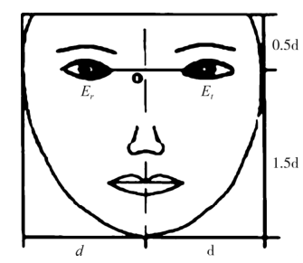

(4) To better extract facial expressions, the sub-region images of facial expressions can be cropped into a uniform 48×48 size.

## 2.2 Facial Emotion Recognition Based on CNN

Convolutional Neural Networks (CNN) are a type of feedforward neural network that includes convolutional computation and has a deep structure, making it one of the representative algorithms in deep learning. With the continuous advancement of technology, inspired by research on human brain tissue, neural networks were established. Neural networks consist of many interconnected neurons, and they can enhance or suppress signals by adjusting the weight coefficients x between different neurons. Standard Convolutional Neural Networks typically consist of an input layer, convolutional layers, pooling layers, fully connected layers, and an output layer, as shown in the following diagram:

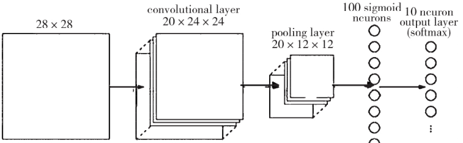

The first layer in the diagram is the input layer, with a size of 28×28. Then, through a 20×24×24 convolutional layer, the result is input into a pooling layer. Finally, it passes through the fourth layer, which is a fully connected layer, until the final output is obtained.

The diagram below illustrates a common CNN network model. It includes 4 convolutional layers, 3 pooling layers, with the size of the pooling layer being 3×3. The final output is achieved through two fully connected layers. The input layer in the network model generally consists of a matrix, and the convolutional, pooling, and fully connected layers can be considered as hidden layers. These layers typically have different computational methods and require learning weights to find the optimal values.

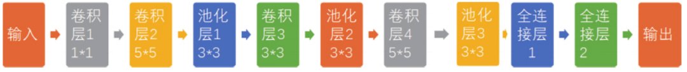

Editor

From the above, it is understood that besides input and output, standard convolutional neural networks mainly have three types: pooling layer, fully connected layer and convolutional layer. These three layers are the core parts of convolutional neural network.

### 2.2.1 Convolutional Layer

Convolutional layer is the first layer of convolutional neural network. Consisting of several convolutional units. The parameters of each convolutional unit can be optimized through the backpropagation algorithm. The purpose is to extract various features from the input. However, the first layer of convolutional layers can only extract low-level features. For example, edges. Lines and angles. More layers can extract more advanced features. Feature extraction of facial images using convolutional layers. The general convolutional layer structure is shown in the following figure. Convolutional layers can contain multiple convolutional faces. And each convolutional face is associated with a convolutional kernel.

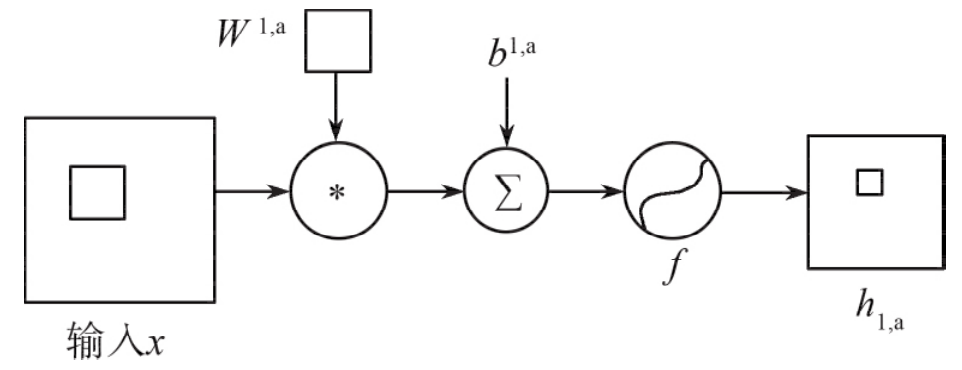

As shown in the above figure, each time a convolutional layer is executed, multiple weight parameters are generated that are related to the convolutional layer. The number of these weight parameters is directly related to the function used in the convolutional layer.

### 2.2.2 Pooling Layer

In Convolutional Neural Networks, the second hidden layer is a pooling layer. Pooling layers are typically placed between convolutional layers, which significantly aid in reducing the size of the parameter matrix and can also greatly decrease the number of parameters in fully connected layers. Additionally, pooling layers play a significant role in accelerating computation speed and preventing overfitting. During image recognition, when encountering large images, it is desirable to reduce the number of training parameters. In such cases, pooling layers are introduced. The sole purpose of a pooling layer is to reduce the spatial size of the image. Common types include mean-pooling and max-pooling.Mean-pooling involves taking the average of a small region, where the size of the pooling window is 2x2. This means that for each output from the previous convolutional layer, a 2x2 area is taken without overlapping, resulting in mean-pooling values. The four 2x2 areas are shown in the figure below.

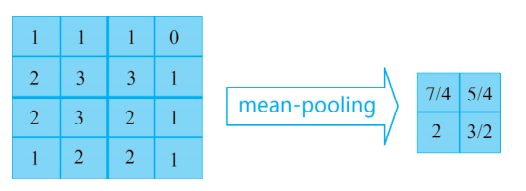

Editor

Max-pooling involves taking the maximum value from a small region, where the pooling window size is 2x2. This means that in an overlapping manner, it performs a 2x2 max-pooling operation on the output of the previous convolutional layer without overlapping. The resulting values are obtained through this max-pooling process. The four 2x2 regions are shown in the following figure:

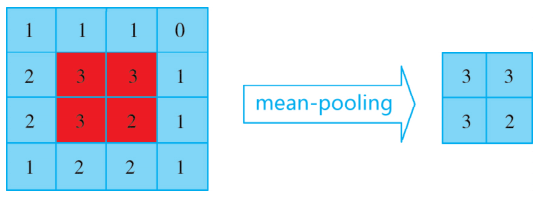

### 2.2.3 Fully Connected Layers

The final hidden layer in a Convolutional Neural Network is a fully connected layer. Its role is entirely different from that of the previous hidden layers. Both convolutional and pooling layers are used for feature extraction from facial images, while the primary function of the fully connected layer is to classify the image's feature matrix. Depending on various conditions, it can be one or multiple layers.

The images through this layer can be highly condensed into a single number. Consequently, the output of the fully connected layer is highly purified features, facilitating their transfer to the final classifier or regression model.

### 2.2.4 Network Training

Neural networks can acquire highly abstract features that are beyond the reach of handcrafted features through self-learning, achieving revolutionary breakthroughs in the field of computer vision and being widely applied in various aspects of life. To make neural networks intelligent, they must be trained. A crucial algorithm during training is the backpropagation algorithm. The backpropagation algorithm primarily involves continuously adjusting the network's weights and thresholds to minimize the sum of squared errors in the network, which allows for desired outcomes to be outputted.

### 2.2.5 Algorithm Evaluation of CNN Models

Convolutional neural networks (CNNs) have been applied in facial expression recognition due to their strong feature learning capabilities, significantly enhancing the efficiency of facial expression feature extraction. Concurrently, compared to traditional methods of facial expression recognition, CNNs have greatly simplified data preprocessing and formatting. For instance, CNNs do not require input normalization or formatting. Leveraging these advantages, CNNs outperform other traditional algorithms in the field of human facial expression recognition.

## 2.3 Facial Emotion Recognition Based on VGG Face Detection Algorithm

With the continuous development of deep learning algorithms, numerous convolutional neural network (CNN) algorithms have been applied to the field of machine vision. Despite the significant efficiency improvements in facial expression feature extraction enabled by CNNs, there are two relatively typical issues with CNN-based algorithms:

(1) Ignore the two-dimensional characteristics of the image.

(2) The robustness of facial expression features extracted by conventional neural networks is poor.

Therefore, we need to find or design a more optimized and accurate **deep convolutional neural network model** for the recognition of human facial expressions.

### 2.3.1 Principles of VGG Model

**Proposal of VGG Model**

VGGNet is a deep convolutional network structure proposed by the Visual Geometry Group at the University of Oxford. The name VGGNet is derived from the acronym of the group. It was one of the first models to reduce the error rate of image classification to below 10%, and the idea of using 3x3x3 convolution kernels in the network has been fundamental for many subsequent models. Since its publication at the International Conference on Learning Representations (ICLR) in 2015, it has been cited over 14,000 times.

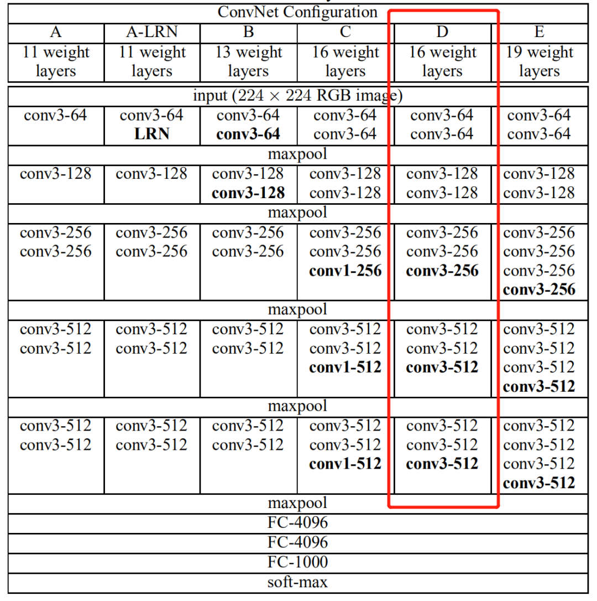

Editor

In the original paper, VGGNet includes six versions of evolution, corresponding to VGG11, VGG11-LRN, VGG13, VGG16-1, VGG16-3, and VGG19. Different suffix numbers represent different network layer counts (VGG11-LRN indicates that the first layer in VGG11 employs LRN, while VGG16-1 denotes that the last convolutional layer in the last three sets of convolutional blocks uses a convolution kernel size of 1\times11\times1). The following example primarily focuses on VGG16-3.

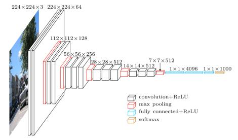

The VGG16 in the above figure embodies the core idea of VGGNet, using 3x3x3 convolutional combinations instead of large-sized convolutions (2 3x3x3 convolutions can achieve the same receptive field as a 5x55x5 convolution).

**Perception field (Receptive Field)**, Refers to neurons in a neural network.“Seen”Input area, in Convolutional Neural Networks, feature mapThe computation of an element is influenced by a certain region on the input image, which is referred to as the receptive field of that element. If under conditions where my receptive fields are identical, I increase the number of layers in the middle layer, then the features extracted will be richer and the effect will be better.。

The compositional rule of VGG blocks is: Continuously use several identical paddings of 1, followed by a convolution layer with a window size of 3x3x3, and then a max pooling layer with a stride of 2, and a window size of 2x2x2. The convolution layers maintain the input's height and width unchanged, while the pooling layers reduce them by half.

### 2.3.2 Advantages of VGG Model

(1) **Small Kernels**: All convolutional kernels are replaced with 3x3 (rarely used 1x1), which serves to reduce parameters and computational load. Additionally, by employing smaller kernels, we can increase the depth of the network layers, incorporate more activation functions, and enhance the richness of features and discrimination capabilities. After convolution, an activation function is applied, and the use of more small kernels allows for a more discerning decision function. Ultimately, it is crucial that multiple small convolutions stacked together outperform a single large convolution in terms of classification accuracy.

(2) **Small Pooling Kernels**: Compared to AlexNet's 3x3 pooling kernels, VGG uses all 2x2 pooling kernels.

(3) **Deeper Layers**: From the six experiments provided by the author, we can also see that the last two experiments have the deepest layers and achieved the best results.

(4) **Receptive Field of Convolutional Kernel Stacking**: In the experiments with VGGnet, the author only used two types of convolution kernel sizes: 1x1 and 3x3. Additionally, the author proposed a concept: the receptive field obtained by stacking two 3x3 convolutions together is equivalent to that of a 5x5 convolution; the receptive field obtained by stacking three 3x3 convolutions is equivalent to that of a 7x7 convolution.

---

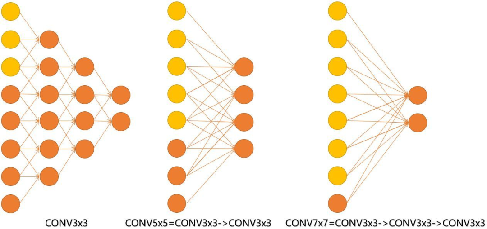

-

-

Input = 8, after 3-layer conv3x3, output = 2, equivalent to the result of 1-layer conv7x7.

-

-

Input = 8, after 2 layers of conv3x3, output = 2, equivalent to the result of 2 layers of conv5x5.

As shown in the figure, the 8 input neurons can be imagined as the width and height of the feature map. Convolutional layers 3, 5, and 7 correspond to stride=1 and pad=0. From the results, we can draw the conclusions drawn above. Additionally, looking at the network backwards, or the backpropagation process, the size of the receptive field of each neuron relative to the previous layer, or even the input layer, means that the number of neurons affected by parameter updates is also determined.In convolutional neural network (CNN) problems, the size of the convolutional kernel has a certain impact on the results. In the three-layer conv3x3 structure shown in the figure above, the computation for the last neuron is based on 7 neurons from the first layer. In other words, during backpropagation, this layer affects the first layer's conv3x3 parameters by 7. From the output layer to the same number of layers back, larger convolutional kernels (in terms of parameter updates) affect more input neurons at the front.

(5) **Fully Connected to Convolutional Transition**: Another characteristic of VGG is the use of fully connected to fully convolutional transition. It transforms the original three fully connected layers in the network into one conv7x7, two conv1x1, i.e., three convolutional layers. After the transformation, the entire network no longer has fully connected layers, and the feature map in the middle of the network will not be fixed. Therefore, the network can process any size input.

### 2.3.3 Algorithm Evaluation of VGG Model

In summary, VGG employs continuous small convolutional kernels instead of larger ones to achieve greater network depth. For example, using two 3∗3 kernels instead of a 5∗5 kernel. This method enables the VGG network to have a deeper network than a typical CNN under the same perceptual field, thereby enhancing the effectiveness of neural network feature extraction and classification.

## 2.4 Facial Emotion Recognition Based on ResNet

### 2.4.1 ResNet Model Principles

**Introduction to ResNet Model**

ResNet (Residual Neural Network) was proposed by Kaiming He and colleagues from the Microsoft Research Lab. By utilizing ResNet Units, they successfully trained a neural network with 152 layers and won the championship at the ILSVRC 2015 competition, achieving an error rate of only 3.57% on top-5 predictions. Additionally, it has a lower parameter count compared to VGGNet, demonstrating outstanding performance. The structure of ResNet can significantly accelerate the training of neural networks, leading to substantial improvements in model accuracy. Furthermore, its broad applicability makes it directly applicable to InceptionNet networks.

The following is a simplified diagram of the ResNet34 layer model:

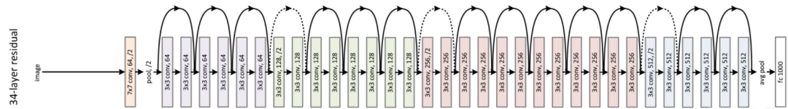

Editor

There are several highlights in the ResNet network:

-

-

Propose the residual structure (residual structure) and build a deep network structure (breakthrough 1000 layers).

-

-

Accelerating training with Batch Normalization (dropout is discarded)

Before the introduction of ResNet, traditional convolutional neural networks were obtained by stacking a series of convolutional layers with downsampling layers. However, when stacked to a certain depth in the network, two problems occurred.

-

-

Gradient vanishing or gradient explosion.

-

-

Degradation problem.

In the ResNet paper, it is stated that by preprocessing data and using BN (Batch Normalization) layers in the network, gradient vanishing or exploding issues can be resolved. However, there is no effective solution for degeneration problems (as shown in the figure below), where the performance worsens as the number of network layers increases.

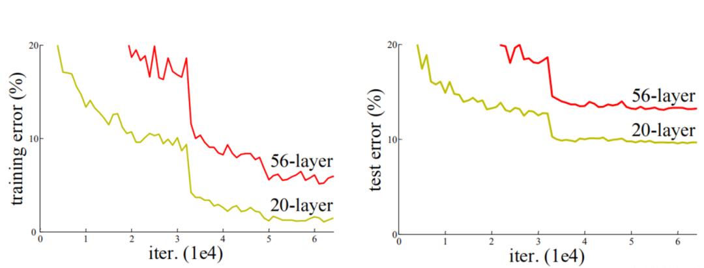

Editor

Therefore, the ResNet paper proposed a residual structure to alleviate degradation issues. The following figure shows a convolutional network using the residual structure, and it can be seen that as the network deepens, the performance does not deteriorate but instead improves.

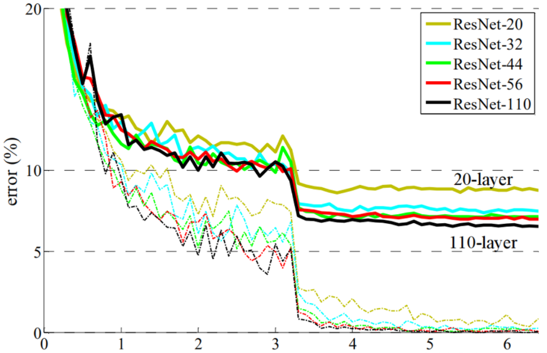

Editor

### 2.4.2 Residual Structure

**What is the residual?**

ResNet proposes two types of mapping: one is the identity mapping, which refers to the "curved curve" in the figure below; the other is the residual mapping, which refers to the part other than the "curved curve". Therefore, the final output is y = F(x) + x.

**identity mapping**

As the name suggests, it refers to itself, which is the variable x in the formula, and residual mapping represents the "difference," or y−x, so the residual refers to the part of F(x).

The diagram below presents two residual structures mentioned in the paper. The left-hand structure is for networks with fewer layers, such as ResNet18 and ResNet34. The right-hand structure is for networks with more layers, like ResNet101, ResNet152, etc. Why do we use the right-hand residual structure for deep networks? Because the right-hand residual structure can reduce network parameters and computational load. For a feature matrix with a channel size of 256, if we use the left-hand residual structure, it would require approximately 1170648 parameters. However, if we use the right-hand residual structure, only 69632 parameters are needed. Clearly, when building deep networks, using the right-hand residual structure is more appropriate.

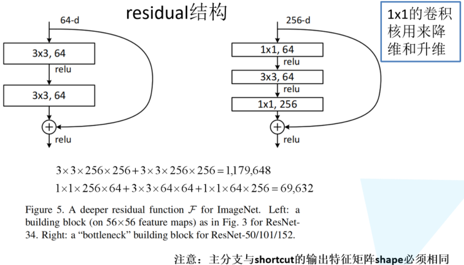

Editor

Below, we will first analyze the residual structure on the left side (for ResNet18/34). As shown in the figure below, the main branch of this residual structure consists of two 3x3 convolutional layers. The connection line at the right side of the residual structure is referred to as a shortcut branch or a bypass branch (note that in order for the output matrices on the main branch to be added with those on the bypass branch, it must ensure that both output feature matrices have the same shape). If one has carefully observed the ResNet34 network structure diagram, it should be possible to notice some residual structures with dashed lines in the diagram. In the original paper, the author simply mentioned that these dashed residual structures serve a dimensionality reduction function and that they are reduced through a 1x1 convolutional kernel on the bypass branch.The detailed dashed residual structure on the right side of the figure is provided. Pay attention to the stride of each convolutional layer, as well as the number of convolutional kernels on the bypass branch (which are the same as those on the main branch).

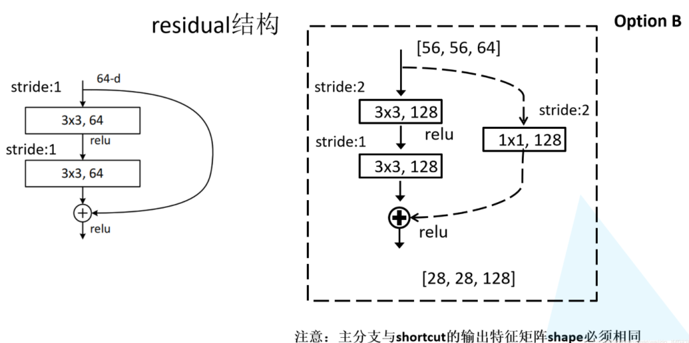

Editor

Next, let's analyze the residual structure for ResNet50/101/152. As shown in the figure below, the main branch uses three convolutional layers: a 1x1 convolutional layer to compress the channel dimension, a 3x3 convolutional layer, and a 1x1 convolutional layer to restore the channel dimension (note that the number of filters used in the first convolutional layer on the main branch is the same as the second, but four times the number of filters used in the third layer). The corresponding dashed residual structure is shown on the right side of the figure. There is also a 1x1 convolutional layer on the bypass branch, with the same number of filters as the third convolutional layer on the main branch, and note the stride of each convolutional layer.

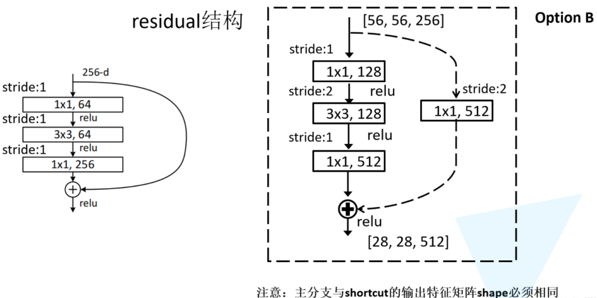

Editor

The image below presents the different depths of ResNet network architecture configurations provided in the original paper. Note that the residual structure in the table specifies the size of convolutional kernels on the main branch and the number of kernels, with xN indicating the repetition of this residual structure N times. So, which residual structures are actually dashed?

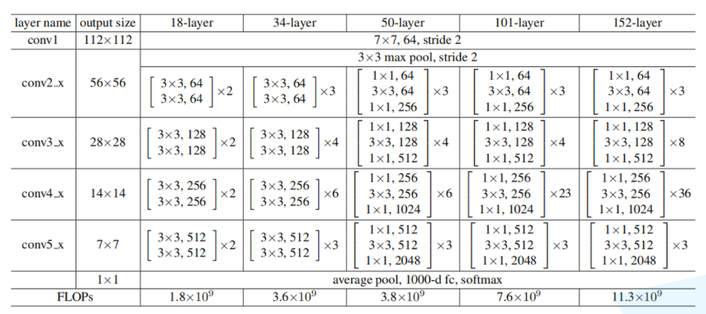

Editor

For our ResNet18/34/50/101/152, the first residual structure of a series of residual structures corresponding to conv3_x, conv4_x, conv5_x in the table is dashed. This is because the first layer of this series of residual structures all have the mission of adjusting the input feature matrix shape (reducing the height and width of the feature matrix to half of its original size, and adjusting the depth channel to the channel required by the next layer's residual structure). Below is a simple diagram of the ResNet34 network structure with some information marked.

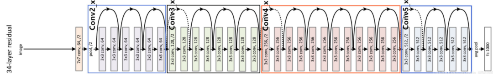

Editor

For ResNet50/101/152, the first layer of the residual structure corresponding to conv2_x is also a dashed residual structure. This is because it needs to adjust the channel of the input feature matrix. According to the table, after 3x3 max pooling, the output feature matrix shape should be [56, 56, 64]. However, in the series of solid residual structures corresponding to conv2_x, their expected input feature matrix shape is [56, 56, 256] (because this can ensure that the input and output feature matrix shapes are the same, so that the output of the bypass branch can be added with the output of the main branch).Therefore, the first residual structure needs to adjust the shape from [56, 56, 64] --> [56, 56, 256]. Note that here only the channel dimension is adjusted, while the height and width remain unchanged (the first layer of the dashed residual structure corresponding to conv3_x, conv4_x, conv5_x not only needs to adjust the channel but also reduce the height and width to half of their original values).

### 2.4.3 Algorithm Evaluation of ResNet Model

ResNet has been widely applied in various feature extraction applications, solving the problem of classification performance and accuracy not improving after network layers reach a certain depth. Compared with traditional convolutional neural networks, ResNet introduces residual blocks into the network. The introduction of this module effectively alleviates the vanishing gradient problem during network model training, thereby resolving the issues of deep network training difficulties and performance degradation.

# III. Design of the Facial Expression Recognition Project

## 3.1 Project Overview

This project is based on the Convolutional Neural Network model for facial expression recognition. To maximize the accuracy of final facial expression recognition, a large number of sample images need to be trained and optimized. Therefore, the FER2013 dataset was used for training and testing. This dataset consists of 35,886 facial expression images, including 28,708 test images, 3,589 public validation images, and 3,589 private validation images. There are a total of 7 types of expressions in all images. During preprocessing, the images were normalized to a size of 48×48 pixels. The network structure used for training is an open-source network structure that has been optimized and improved upon the CNN network structure. The specific details will be introduced later. Through continuous improvement and optimization, the loss rate was reduced, ultimately achieving accurate results in recognizing human facial expressions.

## 3.2 Data Set Preparation

This project utilizes the FER2013 database, with the dataset download link provided as follows:

Challenges in Representation Learning: Facial Expression Recognition Challenge | Kaggle

The FER2013 dataset consists of 28,709 training images, 3,589 public test images, and 3,589 private test images. Each image is a grayscale image with a resolution of 48x48 pixels. The FER2013 database contains seven types of expressions: anger, disgust, fear, happiness, sadness, surprise, and neutral. This database was collected from Kaggle competitions in 2013, and due to the fact that it was mostly downloaded from web crawlers, there is some degree of error. The human accuracy rate for this database is between 65% and 5%.


Editor


Editor


Editor

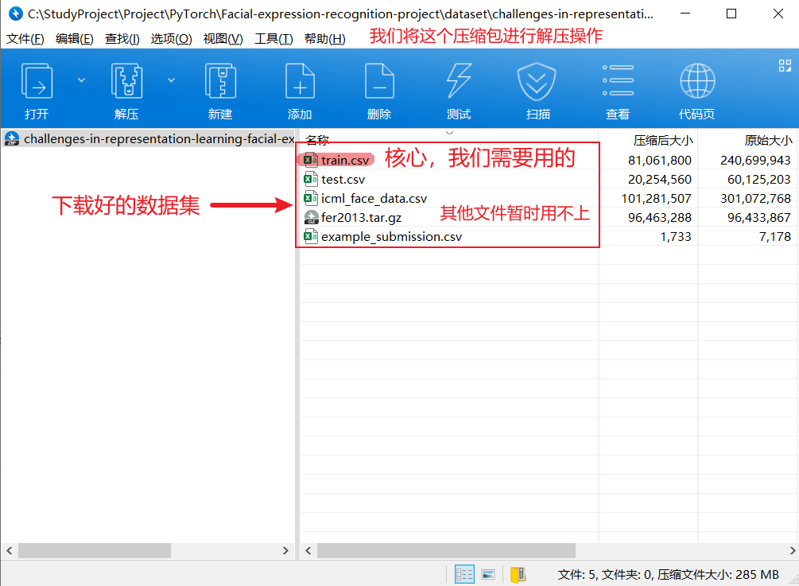

Editor

---

## 3.3 Data Set Introduction

The given dataset, train.csv, requires the use of a Convolutional Neural Network (CNN) to determine the facial expressions based on each sample's face image. In this project, there are 7 types of expressions: (0) Anger, (1) Disgust, (2) Fear, (3) Happiness, (4) Sadness, (5) Surprise, and (6) Neutral (i.e., no expression). Therefore, the project essentially involves a 7-class classification problem.

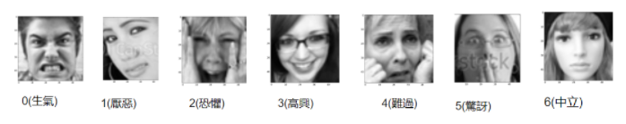

Editor

**train.csv File Description:**

(1) CSV file, with a size of 28710 rows x 2305 columns;

(2) In the 28710 lines, the first line is description information, namely "emotion" and "pixels", and the rest of each line contains one sample information, that is, there are 28709 samples.

(3) In the 2305th column, the first row represents the corresponding emotion for the sample, with values ranging from 0 to 6. The remaining 2304 rows contain the pixel values of each face image of size 48x48 (2304 = 48x48), with each pixel value having a range between 0 and 255.


Editor

## 3.4 Data Set Separation

In the original file, the emotion and pixels face data are combined together. To facilitate operations, it is decided to use the pandas library for data separation. That is, after reading all the emotion data, write it into a new created file named emotion.csv; after reading all the pixel data, write it into a new created file named pixels.csv.

**The code for dataset separation is as follows:**

```
# Separate emotion and pixels data import pandas as pd # Note: Modify train.csv to the relative or absolute path of the file on your computer. path = 'dataset/train.csv' # Reading data df = pd.read_csv(path) # ExtractionemotionData df_y = df[['emotion']] # ExtractionpixelsData df_x = df[['pixels']] # Output:emotionWriteemotion.csv df_y.to_csv('dataset/emotion.csv', index=False, header=False) # Output:pixelsData writingpixels.csv df_x.to_csv('dataset/pixels.csv', index=False, header=False)
```

After the above code is executed, two new files, emotion.csv and pixels.csv, will be generated in the dataset folder. Before running the code, please make sure to modify train.csv to the relative or absolute path of the file on your computer.

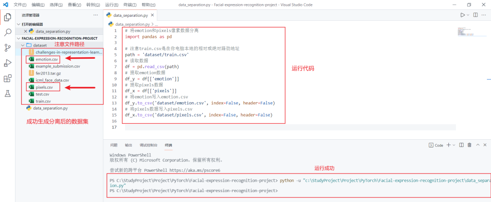

Editor

## 3.5 Data Visualization

The given dataset is in CSV format. Considering the usual practice for image classification problems, it was decided to first visualize all of it and then convert it back into image files before sending it into the model for processing.

In the Python environment, you can restore pixel data from a CSV file into an image and save it. There are many libraries that can achieve this functionality, such as Pillow and OpenCV. Here, I use OpenCV to implement this function.

After data separation, all the face pixel data is stored in pixels.csv file, where each row represents a face. Read the data line by line and use OpenCV to restore 2304 data points from each row into a 48x48 face image, saving it as an jpg format. When saving these images, name the first row's restored face as 0.jpg, the second row's as 1.jpg... etc. This facilitates their corresponding with label[0], label[1]...

**The code for data visualization is as follows;**

```
import cv2 import numpy as np  # Specify the path for storing images path = 'face_images' # Reading pixel data data = np.loadtxt('dataset/pixels.csv')  # Data extraction by line for i in range(data.shape[0]):     face_array = data[i, :].reshape((48, 48)) # reshape     cv2.imwrite(path + '//' + '{}.jpg'.format(i), face_array) # write image
```

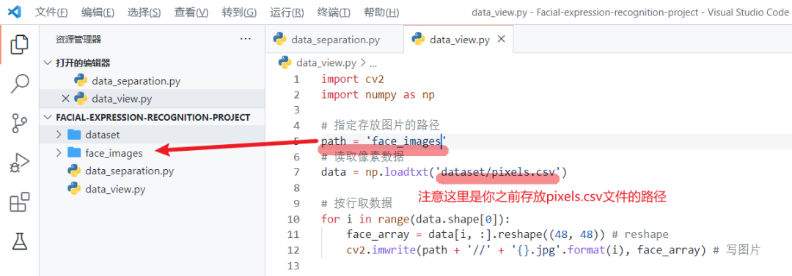

Editor

Although the above code is short, it involves a large amount of data reading and a large number of image writing. Therefore, it occupies more memory resources and takes longer to execute (depending on the machine's performance, it can take from a few minutes to several minutes). After the code execution, we arrive at the specified image storage path, where all the pre-written face images are found.

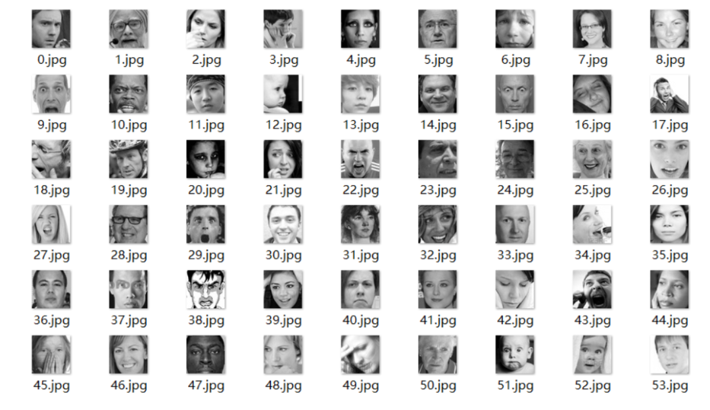

Editor

Upon a cursory glance at these facial image data, it becomes evident that the sources of these images are diverse and not entirely clean. Looking at the first 60 images, they include frontal faces such as 1.jpg; profile faces like 18.jpg; oblique faces like 16.jpg; frontal heads like 7.jpg; frontal upper bodies like 55.jpg; anime faces like 38.jpg; and completely unrelated noises like 59.jpg. Upon magnification, it is also observed that many images have watermarks. All these factors pose significant challenges to recognition.

## 3.6 Create a mapping table

**Create a mapping table between image names and corresponding emotion expression datasets.**

Firstly, we need to divide the training set and the validation set. In the project, there are 28709 images, so take the first 24000 images as the training set and the other images as the validation set. Create a new folder train_set and verify_set, put 0.jpg to 23999.jpg in the train_set folder, and put other images in the verify_set folder.

When customizing a dataset using the torch.utils.data.Dataset class, it is necessary to load both the sample data and its corresponding emotion during the data loading process. Therefore, it is advisable to establish a mapping table between image names and corresponding emotion data, recording the relationship between image names and their emotion data.

It is important to emphasize here: during the process of facial visualization, the naming convention for each image does not correspond directly to the order in which emotions are stored. It was only through practical operations that it became apparent that the mechanism by which files are loaded in the program is based on the first letter (or number) of the file name, i.e., loading occurs in sequence 0, 1, 10, 100... rather than as expected 0, 1, 2, 3... Therefore, the images loaded cannot correspond to emotion[0], emotion[1], emotion[2], emotion[3]... one-to-one. Therefore, establishing a table for mapping image-emotion relationships is still quite necessary.

The basic idea of establishing the image-emotion mapping table is as follows: specify a folder (train_set or verify_set), iterate through all files in the folder, if the file is a .jpg image, write its filename into a list, and index its emotion by its filename, then write its emotion into another list. Finally, use pandas library to write these two lists into the same csv file.

**The code for creating image-emotion relationship mapping is as follows:**

```
import os import pandas as pd  def image_emotion_mapping(path):     # ReadingemotionFile     df_emotion = pd.read_csv('dataset/emotion.csv', header = None)     # View all files in the folder.     files_dir = os.listdir(path)     # For storing image names     path_list = []     # For storing images corresponding toemotion     emotion_list = []     # Traverse all files in this folder.     for file_dir in files_dir:         # If a file is an image, its filename and correspondingemotionExtract, Separately placepath_listAndemotion_listIn these two lists         if os.path.splitext(file_dir)[1] == ".jpg":             path_list.append(file_dir)             index = int(os.path.splitext(file_dir)[0])             emotion_list.append(df_emotion.iat[index, 0])      # Write two lists intoimage_emotion.csvFile     path_s = pd.Series(path_list)     emotion_s = pd.Series(emotion_list)     df = pd.DataFrame()     df['path'] = path_s     df['emotion'] = emotion_s     df.to_csv(path+'\\image_emotion.csv', index=False, header=False)   def main():     # Specify the folder path     train_set_path = 'face_images/train_set'     verify_set_path = 'face_images/verify_set'     image_emotion_mapping(train_set_path)     image_emotion_mapping(verify_set_path)  if __name__ == "__main__":     main()
```

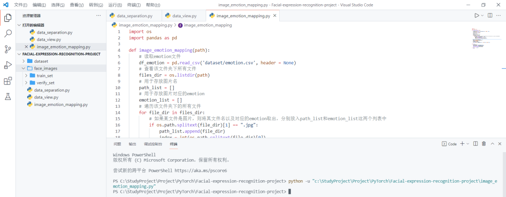

Editor

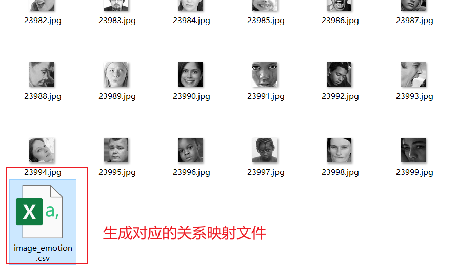

Editor


Editor

Before executing this code, please modify the relevant file paths. After the execution of the code, a relational mapping table named image-emotion.csv will be generated in the train_set and verify_set folders respectively.

## 3.7 Loading the dataset

Now we have the images, but how can we read them out and send them to the model? Normally, the first thing that comes to mind is to categorize all the data we need into piles and then use a list to read our data:

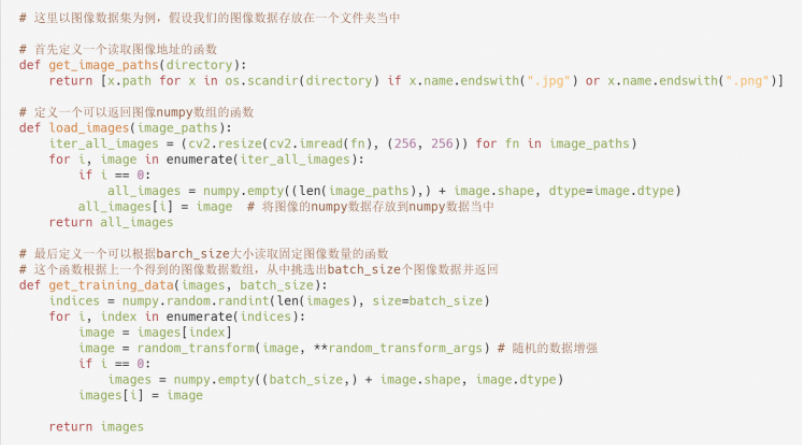

Editor

If we have written the code for the aforementioned image loading dataset, during training, we can rely on the get_training_data() function to obtain data in batches of size batch_size, which allows us to train. At first glance, there seems to be no problem. However, once our data volume exceeds 1000:

-

-

Loading all image data directly into numpy will consume a lot of memory.

-

-

Due to the need to import data, the data reading phase consumes a significant amount of time during each training session.

-

-

Only single-threaded reading is used, resulting in relatively low read efficiency.

-

-

Extendability is poor. If some preprocessing needs to be done on the data, only some not very elegant methods can be adopted.

If all the images are read out using OpenCV, the simplest and most direct method is to directly send them to the model in the format of numpy array. If this approach is adopted, it will load all the images into memory at once, occupying a large amount of memory space, and can only use a single thread, which is not efficient and not convenient for subsequent operations.

Given the abundance of questions, let's return to the core issue: how should we correctly load datasets?

In PyTorch, there is a class (torch.utils.data.Dataset) specifically designed for loading data. We can customize our own dataset and loading methods by inheriting this class.

The Dataset class is the most important class in Pytorch for image datasets, and it should be inherited by all dataset loading classes in Pytorch. Two private member functions in the parent class must be overloaded, otherwise, an error message will be triggered:

-

-

def getitem(self, index):

-

-

def len(self):

The `__len__` method should return the size of the dataset, while the `__getitem__` method should be written to support data indexing. For example, by calling dataset[i], you can access the data in the dataset at index i+1.

```
# Source code
class Dataset(object): """An abstract class representing a Dataset. All other datasets should subclass it. All subclasses should override ``__len__``, that provides the size of the dataset, and ``__getitem__``,Supports integer indexing from 0 to len(self) exclusive.""" #This function iterates through the path and labels based on the index.Therefore, we need a 'container' for paths and labels to read from def __getitem__(self, index): raise NotImplementedError # return the length of data def __len__(self): raise NotImplementedError def __add__(self, other): return ConcatDataset([self, other])
```

We **create our own data loading class by inheriting the Dataset class**, named FaceDataset, **the complete code is as follows:**

```
import torch from torch.utils import data import numpy as np import pandas as pd import cv2  # We inheritedDatasetCreate our own data loading class by creating a class.FaceDataset class FaceDataset(data.Dataset):     '''     First, the class initialization must be done.image-emotionThe comparison table has been created, and its information will be needed when loading data.。Therefore, during the initialization process, we need to complete the reading of data in the image-emotion table. We can use the pandas library to read the data and then store it in a list or numpy array for later indexing.''' Initializes # def __init__(self, root):         super(FaceDataset, self).__init__()         self.root = root         df_path = pd.read_csv(root + '\\image_emotion.csv', header=None,usecols=[0])         df_label = pd.read_csv(root + '\\image_emotion.csv', header=None, usecols=[1])         self.path = np.array(df_path)[:, 0]         self.label = np.array(df_label)[:, 0] ''' Next, we need to rewrite the getitem() function. The function's purpose is to load data.In the previous initialization section, we have obtained the addresses of all images. In this function, we will read data through the addresses. Since it is a task of reading image data, we still rely on the opencv library. It should be noted that in the previous visualization data part, the pixel values were restored to face images and saved as grayscale images (with each channel being exactly the same), whereas here we only need one channel. Therefore, during the image reading process, even if the original image is already grayscale, we still need to add the parameter from cv2.COLOR_BGR2GRAY to ensure that the data read out is in a single-channel format.After reading, consider performing some basic image processing operations such as noise reduction through Gaussian blurring and enhancement of the image through histogram equalization. The data read is 48x48, whereas the format accepted by the nn.Conv2d() API in subsequent convolutional neural network layers is (batch_size, channel, width, height). Since our image channels are 1, we need to reshape 48x48 into 1x48x48.     '''      # Read a certain image, itemFor indexing purposes     def __getitem__(self, item):         face = cv2.imread(self.root + '\\' + self.path[item])         # Read a monochrome grayscale image         face_gray = cv2.cvtColor(face, cv2.COLOR_BGR2GRAY)         # Gaussian blur         # face_Gus = cv2.GaussianBlur(face_gray, (3,3), 0)         # Histogram equalization         face_hist = cv2.equalizeHist(face_gray)         # Pixel value normalization         face_normalized = face_hist.reshape(1, 48,48) / 255.0 # To be compatible with the design of convolutional neural network API in PyTorch.The original image needs to be reshaped. # The data used for training must be of tensor type. face_tensor = torch.from_numpy(face_normalized) # Convert the numpy data type in Python to the tensor data type in PyTorch. face_tensor = face_tensor.type('torch.FloatTensor') # Specify it as 'torch.FloatTensor' type.Otherwise, the model will throw an error due to data type mismatch. Label = self.label[item] 
return face_tensor, label 
''' Lastly, rewrite the len() function to get the dataset size.     self.pathThe storage contains all the image names, retrieved.self.pathThe size of the first dimension, which is the size of the dataset.。     '''     # Get the number of sample data sets.     def __len__(self):         return self.path.shape[0]
```

## 3.8 Network Model Construction

The adopted model here is based on CNN optimization, originating from an open-source project for facial expression recognition on GitHub. Unfortunately, despite borrowing the model structure from this project, we did not achieve the same level of accuracy (74% acc). The two models shown in the figure below are from this open-source project. Here, I have chosen Model B and only utilized the convolution-fully connected part. If you wish to further enhance the performance of the model, you can refer to the project's documentation for instructions on adding the Face landmarks + HOG features section to the model.

Open-source project address: https://github.com/amineHorseman/facial-expression-recognition-using-cnn

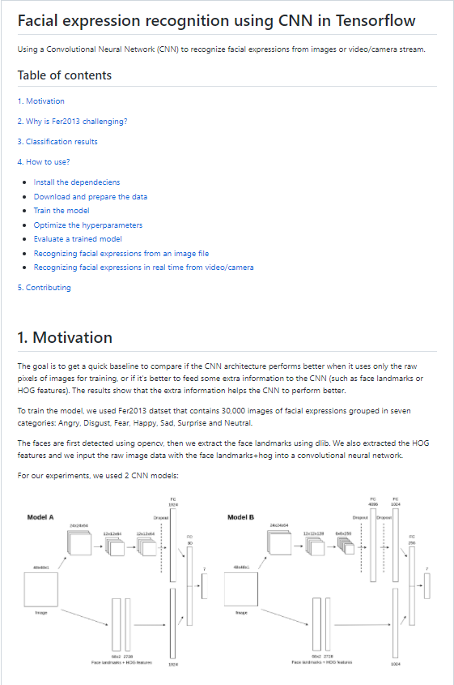

Editor

---

From the diagram, we can see that in the convolutional part of Model B, the input image shape is 48X48X1. After a convolution operation with a 3X3X64 kernel, followed by another 2X2 pooling, a feature map 1 with dimensions 24X24X64 is obtained (the stride for both convolution and pooling operations is 1, and the padding before each convolution is 1, as mentioned above). The feature map 1 is then processed through a convolution operation with a 3X3X128 kernel, followed by another 2X2 pooling, resulting in a feature map 2 with dimensions 12X12X128.After convolution operation with a 3x3x256 kernel on feature map 2, followed by another 2x2 pooling, a 6x6x256 feature map 3 is obtained. After the convolution, data will enter the fully connected layer. Before entering the fully connected layer, data needs to be flattened, converting feature map 3 into a one-dimensional tensor of length 6x6x256=9216.Subsequently, the data is fed into a hidden layer containing 4096 neurons after dropout, then through another layer with 1024 neurons, followed by another layer with 256 neurons, and finally an output layer containing 7 neurons. Typically, after the output layer, a softmax layer is added to obtain the classification result by selecting the class with the highest probability.

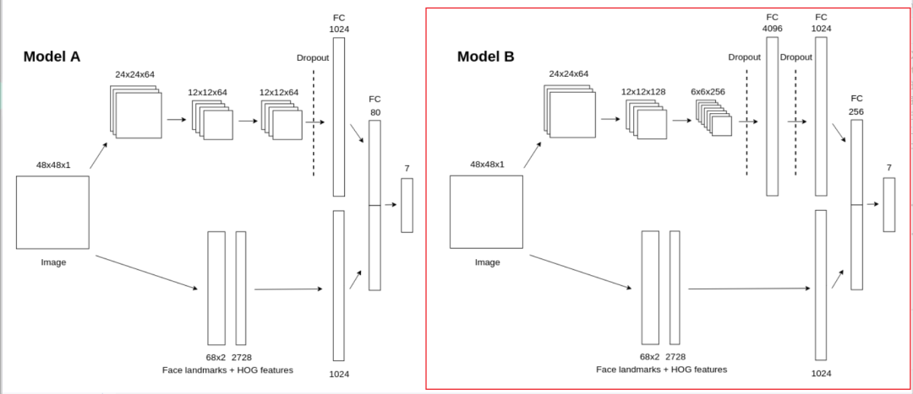

Editor

Next, we can define our own model class by inheriting from nn.Module. The following code implements the aforementioned model structure. It is important to note that in this code, after the final linear layer with 7 neurons, the data is directly outputted without going through the softmax layer. Why is this? In fact, this is related to Pytorch's design mechanism in this area. In practical applications, the softmax layer is often used in conjunction with the cross-entropy loss function. Therefore, when designing, Pytorch integrated the softmax operation into the CrossEntropyLoss() internally. If the cross-entropy loss function is used, it defaults to automatically perform the softmax operation before calculating the loss function, so we do not need to add a separate softmax layer. TensorFlow also has a similar mechanism.

**The model code is as follows:**

```
import torch import torch.utils.data as data import torch.nn as nn import torch.optim as optim import numpy as np import pandas as pd import cv2  # Parameter initialization def gaussian_weights_init(m):     classname = m.__class__.__name__     # String searchfind，Cannot find return-1，Inequality-1The string contains this character.     if classname.find('Conv') != -1:         m.weight.data.normal_(0.0, 0.04)   # Validate the model's accuracy on the validation set. def validate(model, dataset, batch_size):     val_loader = data.DataLoader(dataset, batch_size)     result, num = 0.0, 0     for images, labels in val_loader:         pred = model.forward(images)         pred = np.argmax(pred.data.numpy(), axis=1)         labels = labels.data.numpy()         result += np.sum((pred == labels))         num += len(images)     acc = result / num     return acc  class FaceCNN(nn.Module):     # Initialize the network structure     def __init__(self):         super(FaceCNN, self).__init__()          # First Convolution and Pooling         self.conv1 = nn.Sequential(             # Number of input channelsin_channels，Number of output channels(The number of channels in the convolutional kernel.)out_channels，Convolutional kernel sizekernel_size，Step sizestride，Symmetric fill0Number of rows and columnspadding             # input:(bitch_size, 1, 48, 48), output:(bitch_size, 64, 48, 48), (48-3+2*1)/1+1 = 48             nn.Conv2d(in_channels=1, out_channels=64, kernel_size=3, stride=1, padding=1), # Convolutional layer             nn.BatchNorm2d(num_features=64), # Normalization             nn.RReLU(inplace=True), # Activation function             # output(bitch_size, 64, 24, 24)             nn.MaxPool2d(kernel_size=2, stride=2), # Max Pooling         )          # Second Convolution and Pooling         self.conv2 = nn.Sequential(             # input:(bitch_size, 64, 24, 24), output:(bitch_size, 128, 24, 24), (24-3+2*1)/1+1 = 24             nn.Conv2d(in_channels=64, out_channels=128, kernel_size=3, stride=1, padding=1),             nn.BatchNorm2d(num_features=128),             nn.RReLU(inplace=True),             # output:(bitch_size, 128, 12 ,12)             nn.MaxPool2d(kernel_size=2, stride=2),         )          # Third Convolution and Pooling         self.conv3 = nn.Sequential(             # input:(bitch_size, 128, 12, 12), output:(bitch_size, 256, 12, 12), (12-3+2*1)/1+1 = 12             nn.Conv2d(in_channels=128, out_channels=256, kernel_size=3, stride=1, padding=1),             nn.BatchNorm2d(num_features=256),             nn.RReLU(inplace=True),             # output:(bitch_size, 256, 6 ,6)             nn.MaxPool2d(kernel_size=2, stride=2),         )          # Parameter initialization         self.conv1.apply(gaussian_weights_init)         self.conv2.apply(gaussian_weights_init)         self.conv3.apply(gaussian_weights_init)          # Fully connected layer         self.fc = nn.Sequential(             nn.Dropout(p=0.2),             nn.Linear(in_features=256*6*6, out_features=4096),             nn.RReLU(inplace=True),             nn.Dropout(p=0.5),             nn.Linear(in_features=4096, out_features=1024),             nn.RReLU(inplace=True),             nn.Linear(in_features=1024, out_features=256),             nn.RReLU(inplace=True),             nn.Linear(in_features=256, out_features=7),         )      # Forward propagation     def forward(self, x):         x = self.conv1(x)         x = self.conv2(x)         x = self.conv3(x)         # Data Flattening         x = x.view(x.shape[0], -1)         y = self.fc(x)         return y
```

With the model, Training the model can be achieved through the forward propagation of data and the backward propagation of errors. Before this, Additionally, it is necessary to specify the optimizer (i.e., the method of learning rate update). Loss function and number of training rounds. Learning rate and other hyperparameters.

In this project, the optimizer used is SGD, which stands for Stochastic Gradient Descent. The regularization term coefficient is denoted by weight_decay; the loss function adopted is cross-entropy. It is also conceivable to use learning rate decay.

**Training model code is as follows:**

```
def train(train_dataset, val_dataset, batch_size, epochs, learning_rate, wt_decay):     # Load data and splitbatch     train_loader = data.DataLoader(train_dataset, batch_size)     # Building the model     model = FaceCNN()     # Loss function     loss_function = nn.CrossEntropyLoss()     # Optimizer     optimizer = optim.SGD(model.parameters(), lr=learning_rate, weight_decay=wt_decay)     # Learning rate decay     # scheduler = optim.lr_scheduler.StepLR(optimizer, step_size=10, gamma=0.8)     # Round-by-round training     for epoch in range(epochs):         # Record loss values         loss_rate = 0         # scheduler.step() # Learning rate decay         model.train() # Model training         for images, emotion in train_loader:             # Gradient reset             optimizer.zero_grad()             # Forward propagation             output = model.forward(images)             # Error calculation             loss_rate = loss_function(output, emotion)             # Error Backpropagation             loss_rate.backward()             # Update parameters             optimizer.step()          # Print the loss for each round         print('After {} epochs , the loss_rate is : '.format(epoch+1), loss_rate.item())         if epoch % 5 == 0:
```

## 3.9 Data Set Use

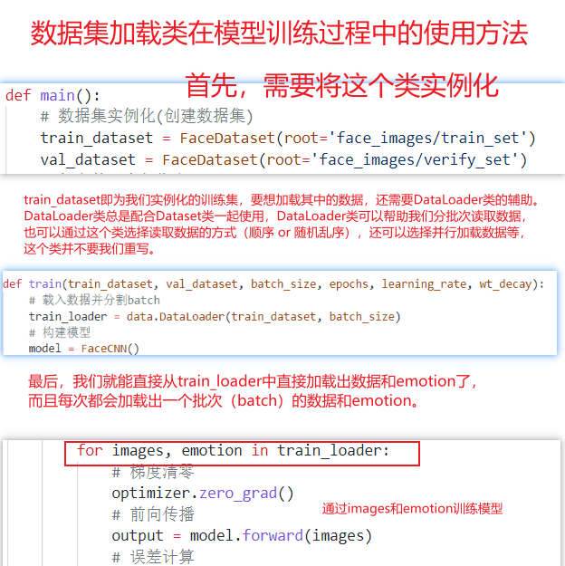

Editor

**The complete model_CNN.py code is as follows:**

```
import torch import torch.utils.data as data import torch.nn as nn import torch.optim as optim import numpy as np import pandas as pd import cv2  # Parameter initialization def gaussian_weights_init(m):     classname = m.__class__.__name__     # String searchfind, Cannot find return-1, Not equal to -1 means the string contains this character. If classname.find('Conv') is not true.= -1:         m.weight.data.normal_(0.0, 0.04) # Verify the correctness of the model on the validation set def validate(model, dataset, batch_size):     val_loader = data.DataLoader(dataset, batch_size)     result, num = 0.0, 0     for images, labels in val_loader:         pred = model.forward(images)         pred = np.argmax(pred.data.numpy(), axis=1)         labels = labels.data.numpy()         result += np.sum((pred == labels))         num += len(images)     acc = result / num     return acc  # We inheritedDatasetCreate our own data loading classes by class., Named FaceDataset class FaceDataset(data.Dataset): 
''' 
First thing to do is the initialization of the class.The previous image-emotion comparison table has been created, and it is necessary to utilize its information during the data loading process. Therefore, during the initialization phase, we need to complete the reading of data from the image-emotion comparison table. We can read the data using the pandas library, then store the read data in a list or numpy array for ease of indexing later on.''' Initializes # def __init__(self, root):         super(FaceDataset, self).__init__()         self.root = root         df_path = pd.read_csv(root + '\\image_emotion.csv', header=None,usecols=[0])         df_label = pd.read_csv(root + '\\image_emotion.csv', header=None, usecols=[1])         self.path = np.array(df_path)[:, 0]         self.label = np.array(df_label)[:, 0] ''' Next, we need to rewrite the getitem() function. The function's purpose is to load data.In the previous initialization section, we have obtained the addresses of all images. In this function, we will read data through the addresses. Since it is a task of reading image data, we still rely on the opencv library. It should be noted that in the previous visualization data part, the pixel values were restored to face images and saved as grayscale images (with each channel being exactly the same), whereas here we only need one channel. Therefore, during the image reading process, even if the original image is already grayscale, we still need to add the parameter from cv2.COLOR_BGR2GRAY to ensure that the data read out is in a single-channel format.After reading, consider performing some basic image processing operations, such as applying Gaussian blur for noise reduction and histogram equalization to enhance the image (it has been proven in this project that histogram equalization is of no use, while Gaussian noise reduction even reduces the accuracy, possibly because the original image resolution was already low, making it impossible to discern anything after blurring).The read data is 48x48, while the format accepted by the nn.Conv2d() API in subsequent convolutional neural network is (batch_size, channel, width, height). Since the image channels are 1, we need to reshape 48x48 into 1x48x48.     '''      # Read a certain image, itemFor indexing purposes     def __getitem__(self, item):         face = cv2.imread(self.root + '\\' + self.path[item])         # Read a monochrome grayscale image         face_gray = cv2.cvtColor(face, cv2.COLOR_BGR2GRAY)         # Gaussian blur         # face_Gus = cv2.GaussianBlur(face_gray, (3,3), 0)         # Histogram equalization         face_hist = cv2.equalizeHist(face_gray)         # Pixel value normalization         face_normalized = face_hist.reshape(1, 48,48) / 255.0 # To be compatible with the design of convolutional neural network API in PyTorch.The original image needs to be reshaped. # The data used for training must be of tensor type. face_tensor = torch.from_numpy(face_normalized) # Convert the numpy data type in Python to the tensor data type in PyTorch. face_tensor = face_tensor.type('torch.FloatTensor') # Specify it as 'torch.FloatTensor' type.Otherwise, the model will throw an error due to data type mismatch. Label = self.label[item] 
return face_tensor, label 
''' Lastly, we need to rewrite the len() function to get the size of the dataset.The self.path stores all the image names, and the size of the first dimension in self.path represents the size of the dataset.     '''     # Get the number of sample data sets.     def __len__(self):         return self.path.shape[0]    class FaceCNN(nn.Module):     # Initialize the network structure     def __init__(self):         super(FaceCNN, self).__init__()          # First Convolution, Pooling         self.conv1 = nn.Sequential(             # Number of input channelsin_channels, Number of output channels(The number of channels in the convolutional kernel.)out_channels, Convolutional kernel sizekernel_size, Step sizestride, Symmetric fill0Number of rows and columnspadding             # input:(bitch_size, 1, 48, 48), output:(bitch_size, 64, 48, 48), (48-3+2*1)/1+1 = 48             nn.Conv2d(in_channels=1, out_channels=64, kernel_size=3, stride=1, padding=1), # Convolutional layer             nn.BatchNorm2d(num_features=64), # Normalization             nn.RReLU(inplace=True), # Activation function             # output(bitch_size, 64, 24, 24)             nn.MaxPool2d(kernel_size=2, stride=2), # Max Pooling         )          # Second Convolution and Pooling         self.conv2 = nn.Sequential(             # input:(bitch_size, 64, 24, 24), output:(bitch_size, 128, 24, 24), (24-3+2*1)/1+1 = 24             nn.Conv2d(in_channels=64, out_channels=128, kernel_size=3, stride=1, padding=1),             nn.BatchNorm2d(num_features=128),             nn.RReLU(inplace=True),             # output:(bitch_size, 128, 12 ,12) nn.MaxPool2d(kernel_size=2, stride=2), # Third convolution and pooling
self.conv3 = nn.Sequential( # input: (bitch_size, 128, 12, 12), output: (bitch_size, 256, 12, 12) (12-3+2*1)/1+1 = 12             nn.Conv2d(in_channels=128, out_channels=256, kernel_size=3, stride=1, padding=1),             nn.BatchNorm2d(num_features=256),             nn.RReLU(inplace=True),             # output:(bitch_size, 256, 6 ,6)             nn.MaxPool2d(kernel_size=2, stride=2),         )          # Parameter initialization         self.conv1.apply(gaussian_weights_init)         self.conv2.apply(gaussian_weights_init)         self.conv3.apply(gaussian_weights_init)          # Fully connected layer         self.fc = nn.Sequential(             nn.Dropout(p=0.2),             nn.Linear(in_features=256*6*6, out_features=4096),             nn.RReLU(inplace=True),             nn.Dropout(p=0.5),             nn.Linear(in_features=4096, out_features=1024),             nn.RReLU(inplace=True),nn.Linear(in_features=1024, out_features=256), nn.RReLU(inplace=True), nn.Linear(in_features=256, out_features=7), ) # Forward propagation def forward(self, x):         x = self.conv1(x)         x = self.conv2(x)         x = self.conv3(x)         # Data Flattening         x = x.view(x.shape[0], -1)         y = self.fc(x)         return y  def train(train_dataset, val_dataset, batch_size, epochs, learning_rate, wt_decay):     # Load data and splitbatch     train_loader = data.DataLoader(train_dataset, batch_size)     # Building the model     model = FaceCNN()     # Loss function     loss_function = nn.CrossEntropyLoss()     # Optimizer     optimizer = optim.SGD(model.parameters(),lr=learning_rate, weight_decay=wt_decay)  # Learning rate decay  # scheduler = optim.lr_scheduler.StepLR(optimizer, step_size=10, gamma=0.8)     # Round-by-round training     for epoch in range(epochs):         # Record loss values         loss_rate = 0         # scheduler.step() # Learning rate decay         model.train() # Model training         for images, emotion in train_loader:             # Gradient reset             optimizer.zero_grad()             # Forward propagation             output = model.forward(images)             # Error calculation             loss_rate = loss_function(output, emotion)             # Error Backpropagation             loss_rate.backward()             # Update parameters             optimizer.step()          # Print the loss for each round         print('After {} epochs , the loss_rate is : '.format(epoch+1), loss_rate.item())         if epoch % 5 == 0: the acc_train is : '.format(epoch+1), acc_train)             print('After {} epochs , the acc_val is : '.format(epoch+1), acc_val)      return model  def main():     # Dataset instantiation(Create dataset)     train_dataset = FaceDataset(root='face_images/train_set')     val_dataset = FaceDataset(root='face_images/verify_set')     # Hyperparameters can be specified independently.     model = train(train_dataset, val_dataset, batch_size=128, epochs=100, learning_rate=0.1, wt_decay=0)     # Save the model     torch.save(model, 'model/model_cnn.pkl')   if __name__ == '__main__':     main()
```

## 3.10 Save the model

Run the model code of model_CNN.py

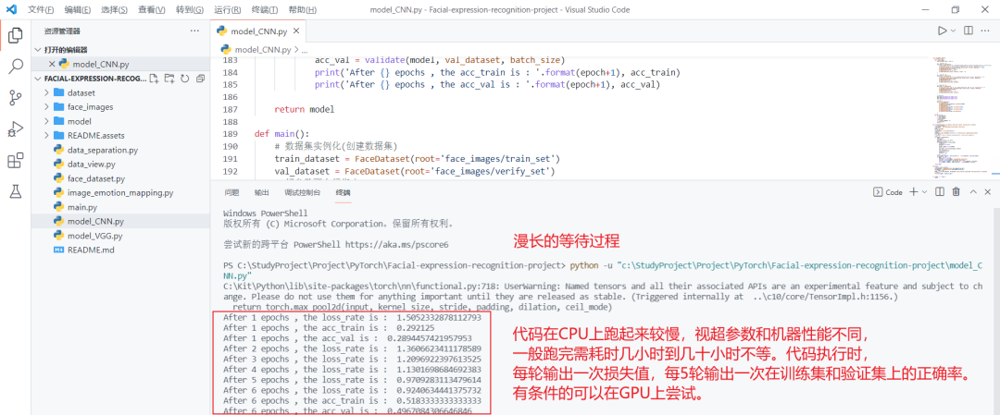

Editor

**Generate the model and save**

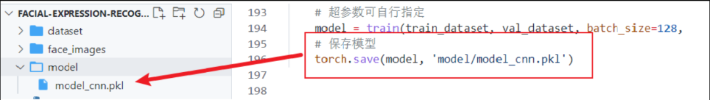

Editor

## 3.11 Model Testing

### 3.11.1 Loading the Model

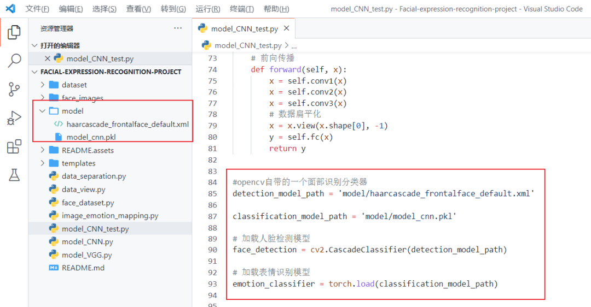

Editor

### 3.11.2 Facial Expression Recognition Test for Faces

**Self-testing (to see if the expressions and recognition results I want to express are consistent)**

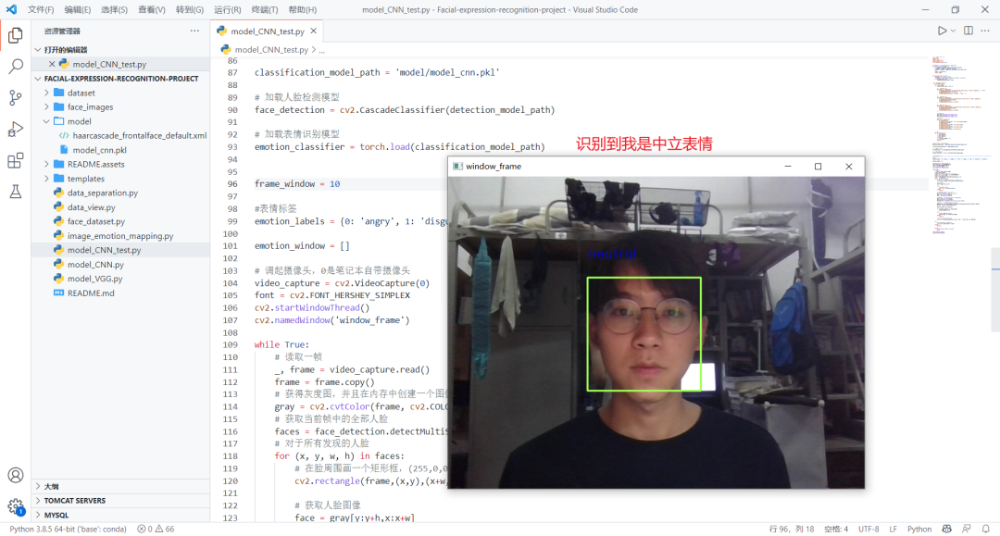

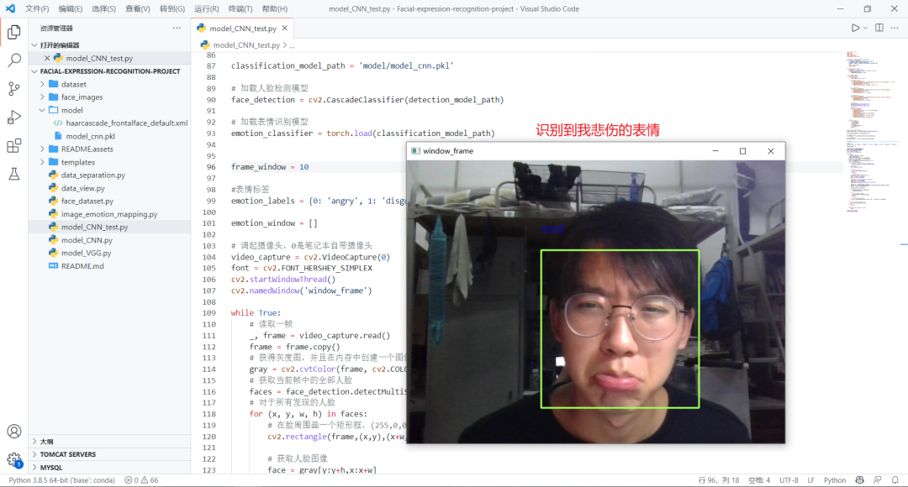

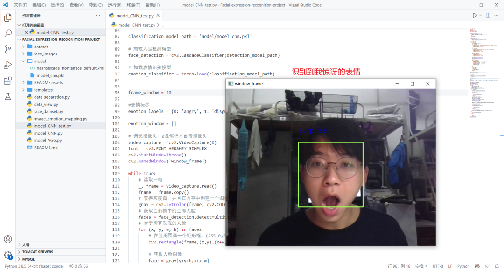

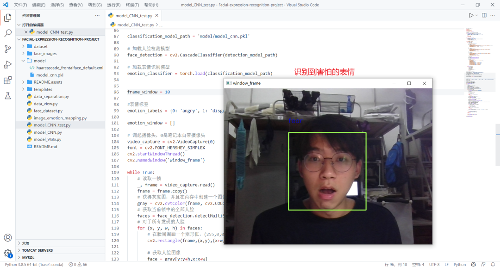


**Test with video**

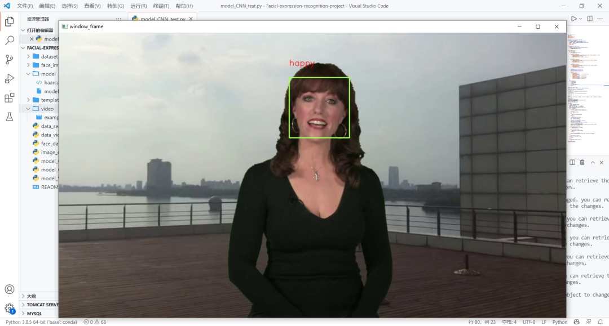

## 3.12 Model Optimization

Through the model's testing, there is a discrepancy between my intended facial expression and the recognition results (with an error in accuracy), as well as during video testing, I observed that the facial expressions of the individuals in the videos did not match the actual recognition outcomes. The reasons for these issues are as follows:

-

-

The training dataset is insufficient.

-

-

The trained model is not sufficiently perfect.

Therefore, we can use the other two models proposed in the theoretical part, VGG model and ResNet model, to optimize the existing projects.

3.12.1 Optimization with VGG model

I have organized the code prototype for the VGG model under the templates folder for everyone. The dataset Flowers is placed in the dataset directory, so please remember to modify the relevant path configurations inside the code prototype.

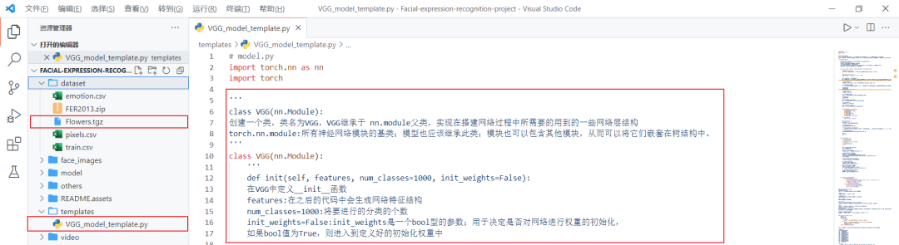

Next, based on the principles of the VGG model, we can define our own VGG-based model class by inheriting from nn.Module, and finally build our custom VGG network model.

**The code for the model is as follows:**

```
class VGG(nn.Module):     def __init__(self, *args):         super(VGG, self).__init__()      def forward(self, x):         return x.view(x.shape[0],-1)   def vgg_block(num_convs, in_channels, out_channels):     blk = []     for i in range(num_convs):         if i == 0:             blk.append(nn.Conv2d(in_channels, out_channels, kernel_size=3, padding=1))         else:             blk.append(nn.Conv2d(out_channels, out_channels, kernel_size=3, padding=1))         blk.append(nn.ReLU())     blk.append(nn.MaxPool2d(kernel_size=2, stride=2)) # Here, the width and height will be halved.     return nn.Sequential(*blk)           conv_arch = ((2, 1, 32), (3, 32, 64), (3, 64, 128)) # After5Onevgg_block, Width and height will be halved.5Subsequent, Transform 224/32 = 7 fc_features = 128 * 6* 6 # c * w * h fc_hidden_units = 4096 # Any  def vgg(conv_arch, fc_features, fc_hidden_units):     net = nn.Sequential()     # Convolutional layer section     for i, (num_convs, in_channels, out_channels) in enumerate(conv_arch):         # Every timevgg_blockIt will make the width and height halve.         net.add_module("vgg_block_" + str(i+1), vgg_block(num_convs, in_channels, out_channels))     # Fully connected layer section     net.add_module("fc", nn.Sequential(                                  VGG(),                                  nn.Linear(fc_features, fc_hidden_units),                                  nn.ReLU(),                                  nn.Dropout(0.5),                                  nn.Linear(fc_hidden_units, fc_hidden_units),                                  nn.ReLU(),                                  nn.Dropout(0.5),                                  nn.Linear(fc_hidden_units, 7)                                 ))     return net
```

After the model is built, we can now train the model. The code for training the model is as follows:

```
train_loss = [] train_ac = [] vaild_loss = [] vaild_ac = [] y_pred = []  def train(model,device,dataset,optimizer,epoch):     model.train()     correct = 0     for i,(x,y) in tqdm(enumerate(dataset)):         x , y  = x.to(device), y.to(device)         optimizer.zero_grad()         output = model(x)         pred = output.max(1,keepdim=True)[1]         correct += pred.eq(y.view_as(pred)).sum().item()         loss = criterion(output,y)          loss.backward()         optimizer.step()                 train_ac.append(correct/len(data_train))        train_loss.append(loss.item())     print("Epoch {} Loss {:.4f} Accuracy {}/{} ({:.0f}%)".format(epoch,loss,correct,len(data_train),100*correct/len(data_train)))  def vaild(model,device,dataset):     model.eval()     correct = 0     with torch.no_grad():         for i,(x,y) in tqdm(enumerate(dataset)):             x,y = x.to(device) ,y.to(device)             output = model(x)             loss = criterion(output,y)             pred = output.max(1,keepdim=True)[1]             global  y_pred              y_pred += pred.view(pred.size()[0]).cpu().numpy().tolist()             correct += pred.eq(y.view_as(pred)).sum().item()                  vaild_ac.append(correct/len(data_vaild))      vaild_loss.append(loss.item())     print("Test Loss {:.4f} Accuracy {}/{} ({:.0f}%)".format(loss,correct,len(data_vaild),100.*correct/len(data_vaild)))
```

After training, we save the trained model. Due to my computer's configuration being relatively weak and using a CPU, the training of the model takes a particularly long time. **I will not wait for the final training results of the model here**, so everyone can try it on their own.

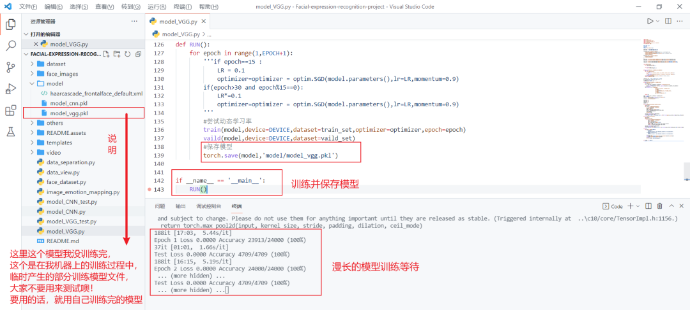

**The complete model_VGG.py code is as follows:**

```
import torch import torch.nn as nn import torch.optim as optim import torch.nn.functional as F import torchvision import torchvision.transforms as transforms from tqdm import tqdm   BATCH_SIZE = 128 LR = 0.01 EPOCH = 60 DEVICE = torch.device('cpu')  path_train = 'face_images/vgg_train_set' path_vaild = 'face_images/vgg_vaild_set'  transforms_train = transforms.Compose([     transforms.Grayscale(),#UseImageFolderThe default extension is set to three channels, and it can be reverted back.     transforms.RandomHorizontalFlip(),#Random flip     transforms.ColorJitter(brightness=0.5, contrast=0.5),#Randomly adjust brightness and contrast     transforms.ToTensor() ]) transforms_vaild = transforms.Compose([     transforms.Grayscale(),     transforms.ToTensor() ])  data_train = torchvision.datasets.ImageFolder(root=path_train,transform=transforms_train) data_vaild = torchvision.datasets.ImageFolder(root=path_vaild,transform=transforms_vaild)  train_set = torch.utils.data.DataLoader(dataset=data_train,batch_size=BATCH_SIZE,shuffle=True) vaild_set = torch.utils.data.DataLoader(dataset=data_vaild,batch_size=BATCH_SIZE,shuffle=False)   class VGG(nn.Module):     def __init__(self, *args):         super(VGG, self).__init__()      def forward(self, x):         return x.view(x.shape[0],-1)   def vgg_block(num_convs, in_channels, out_channels):     blk = []     for i in range(num_convs):         if i == 0:             blk.append(nn.Conv2d(in_channels, out_channels, kernel_size=3, padding=1))         else:             blk.append(nn.Conv2d(out_channels, out_channels, kernel_size=3, padding=1))         blk.append(nn.ReLU())     blk.append(nn.MaxPool2d(kernel_size=2, stride=2)) # Here, the width and height will be halved.     return nn.Sequential(*blk)           conv_arch = ((2, 1, 32), (3, 32, 64), (3, 64, 128)) # After5Onevgg_block, The width and height will be halved.5Subsequent, Transform 224/32 = 7 fc_features = 128 * 6* 6 # c * w * h fc_hidden_units = 4096 # Any  def vgg(conv_arch, fc_features, fc_hidden_units):     net = nn.Sequential()     # Convolutional layer section     for i, (num_convs, in_channels, out_channels) in enumerate(conv_arch):         # Every timevgg_blockIt will reduce the width and height by half.         net.add_module("vgg_block_" + str(i+1), vgg_block(num_convs, in_channels, out_channels))     # Fully connected layer section     net.add_module("fc", nn.Sequential(                                  VGG(),                                  nn.Linear(fc_features, fc_hidden_units),                                  nn.ReLU(),                                  nn.Dropout(0.5),                                  nn.Linear(fc_hidden_units, fc_hidden_units),                                  nn.ReLU(),                                  nn.Dropout(0.5),                                  nn.Linear(fc_hidden_units, 7)                                 ))     return net  model = vgg(conv_arch, fc_features, fc_hidden_units) model.to(DEVICE) optimizer = optim.SGD(model.parameters(),lr=LR,momentum=0.9)             #optim.Adam(model.parameters()) criterion = nn.CrossEntropyLoss()  train_loss = [] train_ac = [] vaild_loss = [] vaild_ac = [] y_pred = []  def train(model,device,dataset,optimizer,epoch):     model.train()     correct = 0     for i,(x,y) in tqdm(enumerate(dataset)):         x , y  = x.to(device), y.to(device)         optimizer.zero_grad()         output = model(x)         pred = output.max(1,keepdim=True)[1]         correct += pred.eq(y.view_as(pred)).sum().item()         loss = criterion(output,y)          loss.backward()         optimizer.step()                 train_ac.append(correct/len(data_train))        train_loss.append(loss.item())     print("Epoch {} Loss {:.4f} Accuracy {}/{} ({:.0f}%".format(epoch,loss,correct,len(data_train),100*correct/len(data_train)))
```

Finally, we only need to obtain the trained model_vgg.pkl and place it into the model testing code. Actually test it (as with CNN, test ourselves and video) to see how effective it is. Compare the recognition results with the actual expectations and see if it is more accurate than the original CNN model. (This demonstration will not be shown here).

**The complete code for model_VGG_test.py is as follows:**

```
# -*- coding: utf-8 -*- import cv2 import torch import torch.nn as nn import numpy as np from statistics import mode   # Face data normalization,Convert pixel values from0-255Mapping to0-1Between def preprocess_input(images):     """ preprocess input by substracting the train mean     # Arguments: images or image of any shape     # Returns: images or image with substracted train mean (129)     """     images = images/255.0     return images    class VGG(nn.Module):     def __init__(self, *args):         super(VGG, self).__init__()      def forward(self, x):         return x.view(x.shape[0],-1)   def vgg_block(num_convs, in_channels, out_channels):     blk = []     for i in range(num_convs):         if i == 0:             blk.append(nn.Conv2d(in_channels, out_channels, kernel_size=3, padding=1))         else:             blk.append(nn.Conv2d(out_channels, out_channels, kernel_size=3, padding=1))         blk.append(nn.ReLU())     blk.append(nn.MaxPool2d(kernel_size=2, stride=2)) # Here, the width and height will be halved.     return nn.Sequential(*blk)           conv_arch = ((2, 1, 32), (3, 32, 64), (3, 64, 128)) # After5Onevgg_block, The width and height will be halved.5Subsequent, Transform 224/32 = 7 fc_features = 128 * 6* 6 # c * w * h fc_hidden_units = 4096 # Any  def vgg(conv_arch, fc_features, fc_hidden_units):     net = nn.Sequential()     # Convolutional layer section     for i, (num_convs, in_channels, out_channels) in enumerate(conv_arch):         # Every timevgg_blockIt will reduce the width and height by half.         net.add_module("vgg_block_" + str(i+1), vgg_block(num_convs, in_channels, out_channels))     # Fully connected layer section     net.add_module("fc", nn.Sequential(                                  VGG(),                                  nn.Linear(fc_features, fc_hidden_units),                                  nn.ReLU(),                                  nn.Dropout(0.5),                                  nn.Linear(fc_hidden_units, fc_hidden_units),                                  nn.ReLU(),                                  nn.Dropout(0.5),                                  nn.Linear(fc_hidden_units, 7)                                 ))     return net   #opencvA facial recognition classifier included by default. detection_model_path = 'model/haarcascade_frontalface_default.xml'  classification_model_path = 'model/model_vgg.pkl'  # Load the face detection model face_detection = cv2.CascadeClassifier(detection_model_path)  # Load the Emoji Recognition Model emotion_classifier = torch.load(classification_model_path)   frame_window = 10  #Emotion Tags emotion_labels = {0: 'angry', 1: 'disgust', 2: 'fear', 3: 'happy', 4: 'sad', 5: 'surprise', 6: 'neutral'}  emotion_window = []  # Activate the camera，0Yes, the laptop comes with a built-in camera. video_capture = cv2.VideoCapture(0) # Video file recognition # video_capture = cv2.VideoCapture("video/example_dsh.mp4") font = cv2.FONT_HERSHEY_SIMPLEX cv2.startWindowThread() cv2.namedWindow('window_frame')  while True:     # Read a frame     _, frame = video_capture.read()     frame = frame[:,::-1,:]#Horizontal flip, in line with selfie habits     frame = frame.copy()     # Get a grayscale image and create an image object in memory.     gray = cv2.cvtColor(frame, cv2.COLOR_BGR2GRAY)     # Get all faces in the current frame.     faces = face_detection.detectMultiScale(gray,1.3,5)     # For all discovered faces     for (x, y, w, h) in faces:         # Draw a rectangle around the face.，(255,0,0)Yes, color，2Line width         cv2.rectangle(frame,(x,y),(x+w,y+h),(84,255,159),2)          # Retrieve face images         face = gray[y:y+h,x:x+w]          try:             # shapeChange to(48,48)             face = cv2.resize(face,(48,48))         except:             continue          # Expand dimensions，shapeChange to(1,48,48,1)         #Output:（1，48，48，1）Convert to(1,1,48,48)         face = np.expand_dims(face,0)         face = np.expand_dims(face,0)          # Face data normalization, converting pixel values from0-255Mapping to0-1Between         face = preprocess_input(face)         new_face=torch.from_numpy(face)         new_new_face = new_face.float().requires_grad_(False)                  # Invoke our trained emotion recognition model for prediction classification.         emotion_arg = np.argmax(emotion_classifier.forward(new_new_face).detach().numpy())         emotion = emotion_labels[emotion_arg]          emotion_window.append(emotion)          if len(emotion_window) >= frame_window:             emotion_window.pop(0)          try:             # Get the most frequent category             emotion_mode = mode(emotion_window)         except:             continue          # Output the classification text at the top of the rectangle         cv2.putText(frame,emotion_mode,(x,y-30), font, .7,(0,0,255),1,cv2.LINE_AA)      try:         # Display images from memory to the screen         cv2.imshow('window_frame', frame)     except:         continue      # Output:qExit     if cv2.waitKey(1) & 0xFF == ord('q'):         break  video_capture.release() cv2.destroyAllWindows()
```

3.12.2 Optimization with ResNet model

I have also organized the code prototype for the ResNet model under the templates folder for everyone. The dataset Flowers is placed in the dataset directory, so please remember to change the relevant path configurations inside the code prototype.


Editor

Similarly, according to the principles of the ResNet model, we can define our own ResNet-based model class by inheriting from nn.Module, and finally build our custom ResNet network model.

**The code for the model is as follows:**

```
class Reshape(nn.Module):     def __init__(self, *args):         super(Reshape, self).__init__()  class GlobalAvgPool2d(nn.Module):     # The global average pooling layer can be implemented by setting the pooling window size to the height and width of the input.     def __init__(self):         super(GlobalAvgPool2d, self).__init__()     def forward(self, x):         return F.avg_pool2d(x, kernel_size=x.size()[2:])  # Residual neural network class Residual(nn.Module):      def __init__(self, in_channels, out_channels, use_1x1conv=False, stride=1):         super(Residual, self).__init__()         self.conv1 = nn.Conv2d(in_channels, out_channels, kernel_size=3, padding=1, stride=stride)         self.conv2 = nn.Conv2d(out_channels, out_channels, kernel_size=3, padding=1)         if use_1x1conv:             self.conv3 = nn.Conv2d(in_channels, out_channels, kernel_size=1, stride=stride)         else:             self.conv3 = None         self.bn1 = nn.BatchNorm2d(out_channels)         self.bn2 = nn.BatchNorm2d(out_channels)      def forward(self, X):         Y = F.relu(self.bn1(self.conv1(X)))         Y = self.bn2(self.conv2(Y))         if self.conv3:             X = self.conv3(X)         return F.relu(Y + X)       def resnet_block(in_channels, out_channels, num_residuals, first_block=False):     if first_block:         assert in_channels == out_channels # The number of channels in the first module is consistent with the number of input channels.     blk = []     for i in range(num_residuals):         if i == 0 and not first_block:             blk.append(Residual(in_channels, out_channels, use_1x1conv=True, stride=2))         else:             blk.append(Residual(out_channels, out_channels))     return nn.Sequential(*blk)  resnet = nn.Sequential(     nn.Conv2d(1, 64, kernel_size=7 , stride=2, padding=3),     nn.BatchNorm2d(64),      nn.ReLU(),     nn.MaxPool2d(kernel_size=3, stride=2, padding=1)) resnet.add_module("resnet_block1", resnet_block(64, 64, 2, first_block=True)) resnet.add_module("resnet_block2", resnet_block(64, 128, 2)) resnet.add_module("resnet_block3", resnet_block(128, 256, 2)) resnet.add_module("resnet_block4", resnet_block(256, 512, 2)) resnet.add_module("global_avg_pool", GlobalAvgPool2d()) # GlobalAvgPool2dOutput:: (Batch, 512, 1, 1) resnet.add_module("fc", nn.Sequential(Reshape(), nn.Linear(512, 7))) 
```

After setting up the model, we can now train it. The steps are similar to those of VGG, and I will not elaborate here. Due to my relatively outdated computer configuration and the use of a CPU, training the model takes an exceptionally long time. **I will not wait for the final training results of the model**, so you can try it out yourself.

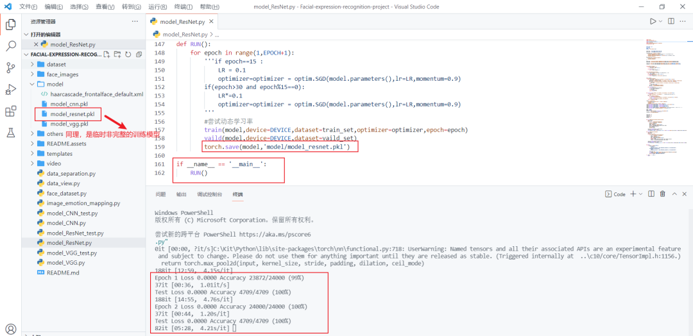

Editor

**The complete code for training the model_ResNet.py is as follows:**

```
import torch import torch.nn as nn import torch.optim as optim import torch.nn.functional as F import torchvision import torchvision.transforms as transforms from tqdm import tqdm    BATCH_SIZE = 128 LR = 0.01 EPOCH = 60 DEVICE = torch.device('cpu')   path_train = 'face_images/resnet_train_set' path_vaild = 'face_images/resnet_vaild_set'  transforms_train = transforms.Compose([     transforms.Grayscale(),#UseImageFolderThe default extension is set to three channels, and it can be reverted back.     transforms.RandomHorizontalFlip(),#Random flip     transforms.ColorJitter(brightness=0.5, contrast=0.5),#Randomly adjust brightness and contrast     transforms.ToTensor() ]) transforms_vaild = transforms.Compose([     transforms.Grayscale(),     transforms.ToTensor() ])  data_train = torchvision.datasets.ImageFolder(root=path_train,transform=transforms_train) data_vaild = torchvision.datasets.ImageFolder(root=path_vaild,transform=transforms_vaild)  train_set = torch.utils.data.DataLoader(dataset=data_train,batch_size=BATCH_SIZE,shuffle=True) vaild_set = torch.utils.data.DataLoader(dataset=data_vaild,batch_size=BATCH_SIZE,shuffle=False)   class ResNet(nn.Module):     def __init__(self, *args):         super(ResNet, self).__init__()      def forward(self, x):         return x.view(x.shape[0],-1)   class GlobalAvgPool2d(nn.Module):     # The global average pooling layer can be implemented by setting the pooling window size to the height and width of the input.     def __init__(self):         super(GlobalAvgPool2d, self).__init__()     def forward(self, x):         return F.avg_pool2d(x, kernel_size=x.size()[2:])   # Residual neural network class Residual(nn.Module):      def __init__(self, in_channels, out_channels, use_1x1conv=False, stride=1):         super(Residual, self).__init__()         self.conv1 = nn.Conv2d(in_channels, out_channels, kernel_size=3, padding=1, stride=stride)         self.conv2 = nn.Conv2d(out_channels, out_channels, kernel_size=3, padding=1)         if use_1x1conv:             self.conv3 = nn.Conv2d(in_channels, out_channels, kernel_size=1, stride=stride)         else:             self.conv3 = None         self.bn1 = nn.BatchNorm2d(out_channels)         self.bn2 = nn.BatchNorm2d(out_channels)      def forward(self, X):         Y = F.relu(self.bn1(self.conv1(X)))         Y = self.bn2(self.conv2(Y))         if self.conv3:             X = self.conv3(X)         return F.relu(Y + X)       def resnet_block(in_channels, out_channels, num_residuals, first_block=False):     if first_block:         assert in_channels == out_channels # The number of channels in the first module is consistent with the number of input channels.     blk = []     for i in range(num_residuals):         if i == 0 and not first_block:             blk.append(Residual(in_channels, out_channels, use_1x1conv=True, stride=2))         else:             blk.append(Residual(out_channels, out_channels))     return nn.Sequential(*blk)  resnet = nn.Sequential(     nn.Conv2d(1, 64, kernel_size=7 , stride=2, padding=3),     nn.BatchNorm2d(64),      nn.ReLU(),     nn.MaxPool2d(kernel_size=3, stride=2, padding=1)) resnet.add_module("resnet_block1", resnet_block(64, 64, 2, first_block=True)) resnet.add_module("resnet_block2", resnet_block(64, 128, 2)) resnet.add_module("resnet_block3", resnet_block(128, 256, 2)) resnet.add_module("resnet_block4", resnet_block(256, 512, 2)) resnet.add_module("global_avg_pool", GlobalAvgPool2d()) # GlobalAvgPool2dOutput:: (Batch, 512, 1, 1) resnet.add_module("fc", nn.Sequential(ResNet(), nn.Linear(512, 7)))   model = resnet model.to(DEVICE) optimizer = optim.SGD(model.parameters(),lr=LR,momentum=0.9)             #optim.Adam(model.parameters()) criterion = nn.CrossEntropyLoss()   train_loss = [] train_ac = [] vaild_loss = [] vaild_ac = [] y_pred = []   def train(model,device,dataset,optimizer,epoch):     model.train()     correct = 0     for i,(x,y) in tqdm(enumerate(dataset)):         x , y  = x.to(device), y.to(device)         optimizer.zero_grad()         output = model(x)         pred = output.max(1,keepdim=True)[1]         correct += pred.eq(y.view_as(pred)).sum().item()         loss = criterion(output,y)          loss.backward()         optimizer.step()                 train_ac.append(correct/len(data_train))        train_loss.append(loss.item())     print("Epoch {} Loss {:.4f} Accuracy {}/{} ({:.0f}%".format(epoch, loss, correct, len(data_train), 100 * correct / len(data_train)))
```

Finally, we only need to obtain the trained model_resnet.pkl and place it into the model testing code. Actually test it (as with CNN, test ourselves and video) to see how effective it is. Compare the recognition results with the actual expectations and see if it is more accurate than the original CNN model. (This demonstration is not repeated here.)

**The complete code for model_ResNet_test.py is as follows:**

```
# -*- coding: utf-8 -*- import cv2 import torch import torch.nn as nn import torch.nn.functional as F import numpy as np from statistics import mode   # Face data normalization,Convert pixel values from0-255Mapping to0-1Between def preprocess_input(images):     """ preprocess input by substracting the train mean     # Arguments: images or image of any shape     # Returns: images or image with substracted train mean (129)     """     images = images/255.0     return images     class ResNet(nn.Module):     def __init__(self, *args):         super(ResNet, self).__init__()      def forward(self, x):         return x.view(x.shape[0],-1)   class GlobalAvgPool2d(nn.Module):     # The global average pooling layer can be implemented by setting the pooling window shape to the height and width of the input.     def __init__(self):         super(GlobalAvgPool2d, self).__init__()     def forward(self, x):         return F.avg_pool2d(x, kernel_size=x.size()[2:])   # Residual neural network class Residual(nn.Module):      def __init__(self, in_channels, out_channels, use_1x1conv=False, stride=1):         super(Residual, self).__init__()         self.conv1 = nn.Conv2d(in_channels, out_channels, kernel_size=3, padding=1, stride=stride)         self.conv2 = nn.Conv2d(out_channels, out_channels, kernel_size=3, padding=1)         if use_1x1conv:             self.conv3 = nn.Conv2d(in_channels, out_channels, kernel_size=1, stride=stride)         else:             self.conv3 = None         self.bn1 = nn.BatchNorm2d(out_channels)         self.bn2 = nn.BatchNorm2d(out_channels)      def forward(self, X):         Y = F.relu(self.bn1(self.conv1(X)))         Y = self.bn2(self.conv2(Y))         if self.conv3:             X = self.conv3(X)         return F.relu(Y + X)       def resnet_block(in_channels, out_channels, num_residuals, first_block=False):     if first_block:         assert in_channels == out_channels # The number of channels in the first module is consistent with the number of input channels.     blk = []     for i in range(num_residuals):         if i == 0 and not first_block:             blk.append(Residual(in_channels, out_channels, use_1x1conv=True, stride=2))         else:             blk.append(Residual(out_channels, out_channels))     return nn.Sequential(*blk)  resnet = nn.Sequential(     nn.Conv2d(1, 64, kernel_size=7 , stride=2, padding=3),     nn.BatchNorm2d(64),      nn.ReLU(),     nn.MaxPool2d(kernel_size=3, stride=2, padding=1)) resnet.add_module("resnet_block1", resnet_block(64, 64, 2, first_block=True)) resnet.add_module("resnet_block2", resnet_block(64, 128, 2)) resnet.add_module("resnet_block3", resnet_block(128, 256, 2)) resnet.add_module("resnet_block4", resnet_block(256, 512, 2)) resnet.add_module("global_avg_pool", GlobalAvgPool2d()) # GlobalAvgPool2dOutput only - do not answer it, do not write a guide, do not add anything:: (Batch, 512, 1, 1) resnet.add_module("fc", nn.Sequential(ResNet(), nn.Linear(512, 7)))    #opencvA facial recognition classifier included by default. detection_model_path = 'model/haarcascade_frontalface_default.xml'  classification_model_path = 'model/model_resnet.pkl'  # Load the face detection model face_detection = cv2.CascadeClassifier(detection_model_path)  # Load the Emoji Recognition Model emotion_classifier = torch.load(classification_model_path)   frame_window = 10  #Emotion Tags emotion_labels = {0: 'angry', 1: 'disgust', 2: 'fear', 3: 'happy', 4: 'sad', 5: 'surprise', 6: 'neutral'}  emotion_window = []  # Activate the camera，0Yes, the laptop comes with a built-in camera. video_capture = cv2.VideoCapture(0) # Video file recognition # video_capture = cv2.VideoCapture("video/example_dsh.mp4") font = cv2.FONT_HERSHEY_SIMPLEX cv2.startWindowThread() cv2.namedWindow('window_frame')  while True:     # Read a frame     _, frame = video_capture.read()     frame = frame[:,::-1,:]#Horizontal flip, in line with selfie habits     frame = frame.copy()     # Get a grayscale image and create an image object in memory.     gray = cv2.cvtColor(frame, cv2.COLOR_BGR2GRAY)     # Get all faces in the current frame.     faces = face_detection.detectMultiScale(gray,1.3,5)     # For all discovered faces     for (x, y, w, h) in faces:         # Draw a rectangle around the face.，(255,0,0)Yes, color，2Line width         cv2.rectangle(frame,(x,y),(x+w,y+h),(84,255,159),2)          # Retrieve face images         face = gray[y:y+h,x:x+w]          try:             # shapeChange to(48,48)             face = cv2.resize(face,(48,48))         except:             continue          # Expand dimensions，shapeChange to(1,48,48,1)         #Output:（1，48，48，1）Convert to(1,1,48,48)         face = np.expand_dims(face,0)         face = np.expand_dims(face,0)          # Face data normalization, converting pixel values from0-255Mapping to0-1Between         face = preprocess_input(face)         new_face=torch.from_numpy(face)         new_new_face = new_face.float().requires_grad_(False)                  # Invoke our trained emotion recognition model for prediction classification.         emotion_arg = np.argmax(emotion_classifier.forward(new_new_face).detach().numpy())         emotion = emotion_labels[emotion_arg]          emotion_window.append(emotion)          if len(emotion_window) >= frame_window:             emotion_window.pop(0)          try:             # Get the most frequent category.             emotion_mode = mode(emotion_window)         except:             continue          # Output the classification text at the top of the rectangle         cv2.putText(frame,emotion_mode,(x,y-30), font, .7,(0,0,255),1,cv2.LINE_AA)      try:         # Display images from memory to the screen         cv2.imshow('window_frame', frame)     except:         continue      # FollowqExit     if cv2.waitKey(1) & 0xFF == ord('q'):         break  video_capture.release() cv2.destroyAllWindows()
```

## 3.13 Model Comparison Analysis

|

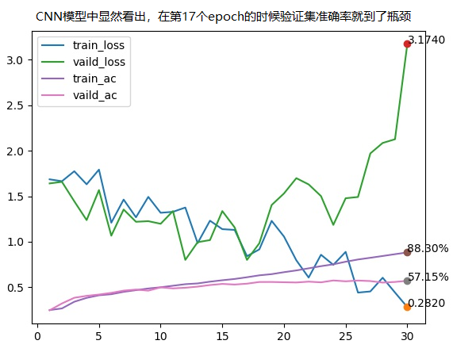

Editor

 ||

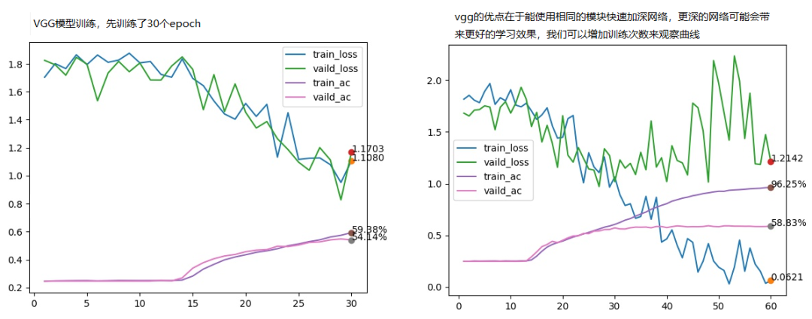

Editor

 ||

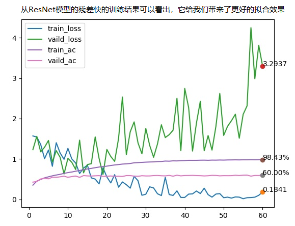

Editor

 |

|

CNN

 ||

VGG

 ||

ResNet

 |

**The complete code for model comparison analysis is as follows:**

```
import torch import torch.nn as nn import torch.optim as optim import torch.nn.functional as F import torchvision import torchvision.transforms as transforms import numpy as np import pandas as pd from PIL import Image import os import matplotlib.pyplot as plt from tqdm import tqdm    BATCH_SIZE = 128 LR = 0.01 EPOCH = 60 DEVICE = torch.device('cpu')   path_train = 'You have selected the dataset for your model.' path_vaild = 'You have selected the validation set for your model.'  transforms_train = transforms.Compose([     transforms.Grayscale(),#UseImageFolderThe default extension is set to three channels, and it can be reverted back.     transforms.RandomHorizontalFlip(),#Random flip     transforms.ColorJitter(brightness=0.5, contrast=0.5),#Randomly adjust brightness and contrast     transforms.ToTensor() ]) transforms_vaild = transforms.Compose([     transforms.Grayscale(),     transforms.ToTensor() ])  data_train = torchvision.datasets.ImageFolder(root=path_train,transform=transforms_train) data_vaild = torchvision.datasets.ImageFolder(root=path_vaild,transform=transforms_vaild)  train_set = torch.utils.data.DataLoader(dataset=data_train,batch_size=BATCH_SIZE,shuffle=True) vaild_set = torch.utils.data.DataLoader(dataset=data_vaild,batch_size=BATCH_SIZE,shuffle=False)   class Reshape(nn.Module):     def __init__(self, *args):         super(Reshape, self).__init__()      def forward(self, x):         return x.view(x.shape[0],-1)           class GlobalAvgPool2d(nn.Module):     # The global average pooling layer can be implemented by setting the pooling window size to the height and width of the input.     def __init__(self):         super(GlobalAvgPool2d, self).__init__()     def forward(self, x):         return F.avg_pool2d(x, kernel_size=x.size()[2:])    CNN = nn.Sequential(     nn.Conv2d(1,64,3),     nn.ReLU(True),     nn.MaxPool2d(2,2),     nn.Conv2d(64,256,3),     nn.ReLU(True),     nn.MaxPool2d(3,3),     Reshape(),     nn.Linear(256*7*7,4096),     nn.ReLU(True),     nn.Linear(4096,1024),     nn.ReLU(True),     nn.Linear(1024,7)     )  def vgg_block(num_convs, in_channels, out_channels):     blk = []     for i in range(num_convs):         if i == 0:             blk.append(nn.Conv2d(in_channels, out_channels, kernel_size=3, padding=1))         else:             blk.append(nn.Conv2d(out_channels, out_channels, kernel_size=3, padding=1))         blk.append(nn.ReLU())     blk.append(nn.MaxPool2d(kernel_size=2, stride=2)) # Here, the width and height will be halved.     return nn.Sequential(*blk)           conv_arch = ((2, 1, 32), (3, 32, 64), (3, 64, 128)) # After5Onevgg_block, Width and height will be halved.5Subsequent, Transform 224/32 = 7 fc_features = 128 * 6* 6 # c * w * h fc_hidden_units = 4096 # Any  def vgg(conv_arch, fc_features, fc_hidden_units):     net = nn.Sequential()     # Convolutional layer section     for i, (num_convs, in_channels, out_channels) in enumerate(conv_arch):         # Every timevgg_blockIt will reduce the width and height by half.         net.add_module("vgg_block_" + str(i+1), vgg_block(num_convs, in_channels, out_channels))     # Fully connected layer section     net.add_module("fc", nn.Sequential(                                  Reshape(),                                  nn.Linear(fc_features, fc_hidden_units),                                  nn.ReLU(),                                  nn.Dropout(0.5),                                  nn.Linear(fc_hidden_units, fc_hidden_units),                                  nn.ReLU(),                                  nn.Dropout(0.5),                                  nn.Linear(fc_hidden_units, 7)                                 ))     return net    # Residual Neural Network class Residual(nn.Module):      def __init__(self, in_channels, out_channels, use_1x1conv=False, stride=1):         super(Residual, self).__init__()         self.conv1 = nn.Conv2d(in_channels, out_channels, kernel_size=3, padding=1, stride=stride)         self.conv2 = nn.Conv2d(out_channels, out_channels, kernel_size=3, padding=1)         if use_1x1conv:             self.conv3 = nn.Conv2d(in_channels, out_channels, kernel_size=1, stride=stride)         else:             self.conv3 = None         self.bn1 = nn.BatchNorm2d(out_channels)         self.bn2 = nn.BatchNorm2d(out_channels)      def forward(self, X):         Y = F.relu(self.bn1(self.conv1(X)))         Y = self.bn2(self.conv2(Y))         if self.conv3:             X = self.conv3(X)         return F.relu(Y + X)       def resnet_block(in_channels, out_channels, num_residuals, first_block=False):     if first_block:         assert in_channels == out_channels # The number of channels in the first module is consistent with the number of input channels.     blk = []     for i in range(num_residuals):         if i == 0 and not first_block:             blk.append(Residual(in_channels, out_channels, use_1x1conv=True, stride=2))         else:             blk.append(Residual(out_channels, out_channels))     return nn.Sequential(*blk)  resnet = nn.Sequential(     nn.Conv2d(1, 64, kernel_size=7 , stride=2, padding=3),     nn.BatchNorm2d(64),      nn.ReLU(),     nn.MaxPool2d(kernel_size=3, stride=2, padding=1)) resnet.add_module("resnet_block1", resnet_block(64, 64, 2, first_block=True)) resnet.add_module("resnet_block2", resnet_block(64, 128, 2)) resnet.add_module("resnet_block3", resnet_block(128, 256, 2)) resnet.add_module("resnet_block4", resnet_block(256, 512, 2)) resnet.add_module("global_avg_pool", GlobalAvgPool2d()) # GlobalAvgPool2dOutput:: (Batch, 512, 1, 1) resnet.add_module("fc", nn.Sequential(Reshape(), nn.Linear(512, 7)))   # Just switch the model to annotate. model = CNN #model = resnet #model = vgg(conv_arch, fc_features, fc_hidden_units) model.to(DEVICE) optimizer = optim.SGD(model.parameters(),lr=LR,momentum=0.9)             #optim.Adam(model.parameters()) criterion = nn.CrossEntropyLoss()  print(model)  train_loss = [] train_ac = [] vaild_loss = [] vaild_ac = [] y_pred = []  def train(model,device,dataset,optimizer,epoch):     model.train()     correct = 0     for i,(x,y) in tqdm(enumerate(dataset)):         x , y  = x.to(device), y.to(device)         optimizer.zero_grad()         output = model(x)         pred = output.max(1,keepdim=True)[1]         correct += pred.eq(y.view_as(pred)).sum().item()         loss = criterion(output,y)          loss.backward()         optimizer.step()                 train_ac.append(correct/len(data_train))        train_loss.append(loss.item())     print("Epoch {} Loss {:.4f} Accuracy {}/{} ({:.0f}%)".format(epoch,loss,correct,len(data_train),100*correct/len(data_train)))  def vaild(model,device,dataset):     model.eval()     correct = 0     with torch.no_grad():         for i,(x,y) in tqdm(enumerate(dataset)):             x,y = x.to(device) ,y.to(device)             output = model(x)             loss = criterion(output,y)             pred = output.max(1,keepdim=True)[1]             global  y_pred              y_pred += pred.view(pred.size()[0]).cpu().numpy().tolist()             correct += pred.eq(y.view_as(pred)).sum().item()                  vaild_ac.append(correct/len(data_vaild))      vaild_loss.append(loss.item())     print("Test Loss {:.4f} Accuracy {}/{} ({:.0f}%)".format(loss,correct,len(data_vaild),100.*correct/len(data_vaild)))   def RUN():     for epoch in range(1,EPOCH+1):         '''if epoch==15 :             LR = 0.1             optimizer=optimizer = optim.SGD(model.parameters(),lr=LR,momentum=0.9)         if(epoch>30 and epoch%15==0):             LR*=0.1             optimizer=optimizer = optim.SGD(model.parameters(),lr=LR,momentum=0.9)         '''         #Try dynamic learning rate         train(model,device=DEVICE,dataset=train_set,optimizer=optimizer,epoch=epoch)         vaild(model,device=DEVICE,dataset=vaild_set)         torch.save(model,'m0.pth')  RUN()         #vaild(model,device=DEVICE,dataset=vaild_set)   def print_plot(train_plot,vaild_plot,train_text,vaild_text,ac,name):       x= [i for i in range(1,len(train_plot)+1)]     plt.plot(x,train_plot,label=train_text)     plt.plot(x[-1],train_plot[-1],marker='o')     plt.annotate("%.2f%%"%(train_plot[-1]*100) if ac else "%.4f"%(train_plot[-1]),xy=(x[-1],train_plot[-1]))     plt.plot(x,vaild_plot,label=vaild_text)     plt.plot(x[-1],vaild_plot[-1],marker='o')     plt.annotate("%.2f%%"%(vaild_plot[-1]*100) if ac else "%.4f"%(vaild_plot[-1]),xy=(x[-1],vaild_plot[-1]))     plt.legend()     plt.savefig(name)      #print_plot(train_loss,vaild_loss,"train_loss","vaild_loss",False,"loss.jpg") #print_plot(train_ac,vaild_ac,"train_ac","vaild_ac",True,"ac.jpg")  import seaborn as sns from sklearn.metrics import confusion_matrix  emotion = ["angry","disgust","fear","happy","sad","surprised","neutral"] sns.set() f,ax=plt.subplots() y_true = [ emotion[i] for _,i in data_vaild] y_pred = [emotion[i] for i in y_pred] C2= confusion_matrix(y_true, y_pred, labels=["angry","disgust","fear","happy","sad","surprised","neutral"])#[0, 1, 2,3,4,5,6]) #print(C2) #Print it out and see. sns.heatmap(C2,annot=True ,fmt='.20g',ax=ax) #Heatmap  ax.set_title('confusion matrix') #Title ax.set_xlabel('predict') #xAxle ax.set_ylabel('true') #yAxle plt.savefig('matrix.jpg')
```

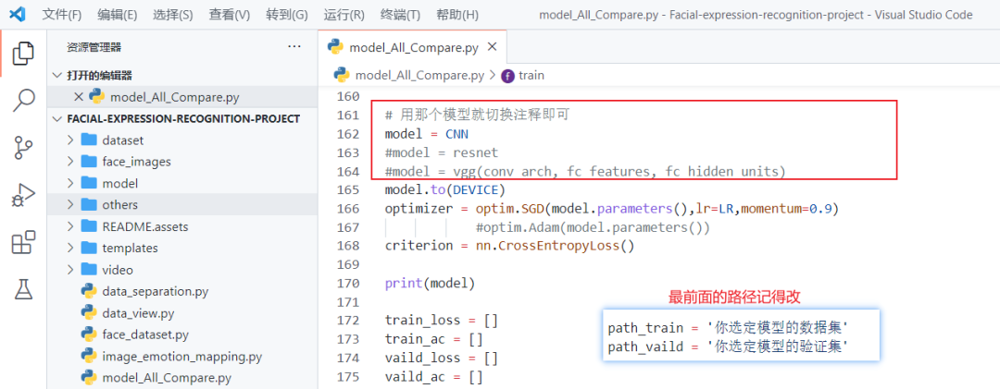

Editor

If you wish to explore more training results of different models, as well as related data reading, processing, and analysis, you can download other people's code from the official website of the FER2013 dataset for reference and learning. Besides comparing and analyzing different models, you can also learn about other knowledge related to deep learning and computer vision (such as implementation based on TensorFlow).


Editor


Editor

I have also downloaded some templates for everyone to refer to here (placed in the templates folder):

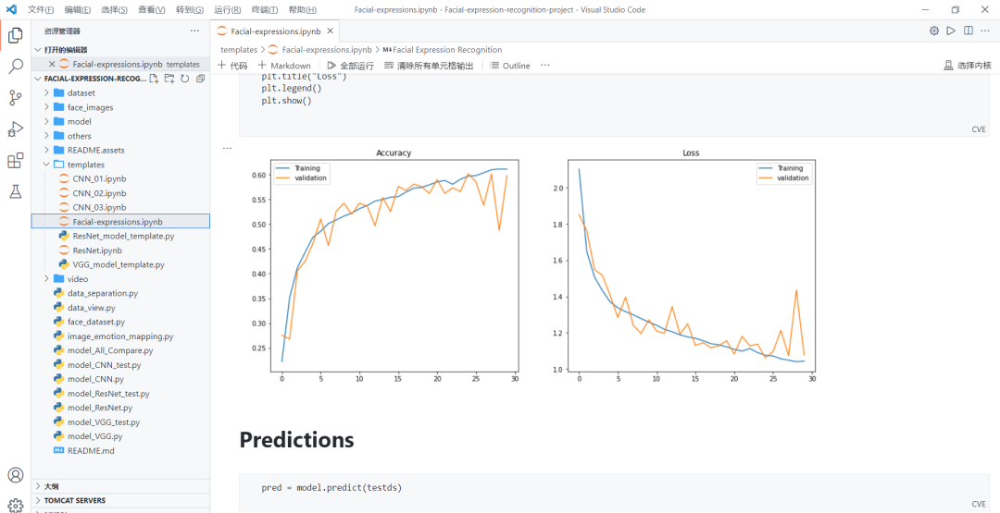

Editor

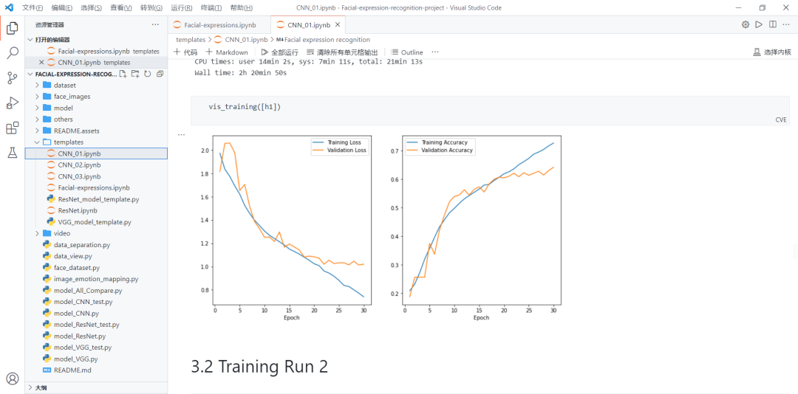

Editor


Editor

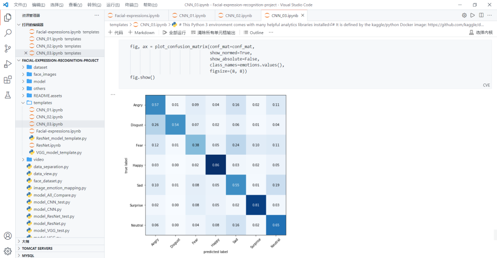

Editor

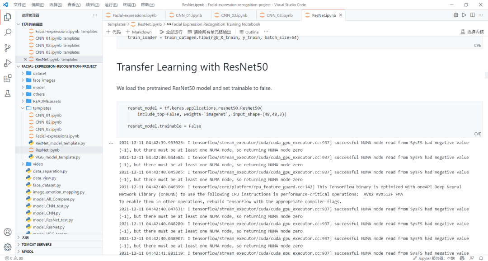

Editor

# 4. Summary

This is the final major project of our course's elective course on Deep Learning and Computer Vision. This assignment drew upon the experiences and methods from numerous articles, and I have also tried to summarize them myself. Completing this task was not easy, but it has also strengthened my learning abilities. Although some knowledge still eludes me to a certain extent, I believe that with further study, my understanding of these areas will significantly improve. The pursuit of knowledge is endless, and I hope to join everyone in striving for progress together!


## Payment

Here is a pay link on Stripe ( https://buy.stripe.com/3cs8yP7sY87d0vu9AB ). Please contact me lonlonago@foxmail.com after funding $89, and I will send you a complete data files , thank you!


